# 예제

예제 앱 14개. 각 디렉터리가 **개념 하나**를 가르치는 작은 Django 앱이다. 읽는 순서는 위에서 아래.

| 예제 | 개념 | 튜토리얼 | 화면 |
|------|------|----------|------|
| [todo](./todo/) | 모델 구독으로 여러 탭이 같은 목록을 함께 본다 | [Todo 앱](../docs/tutorials/03-todo-app.md) | 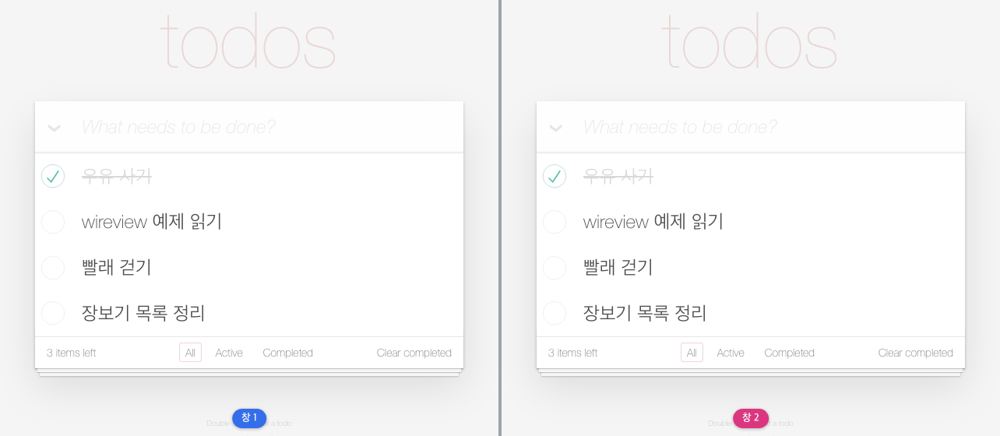 |
| [poll](./poll/) | 쓰기는 핸들러가, 다시 그리기는 브로드캐스트가 | [Poll 앱](../docs/tutorials/10-poll-app.md) | 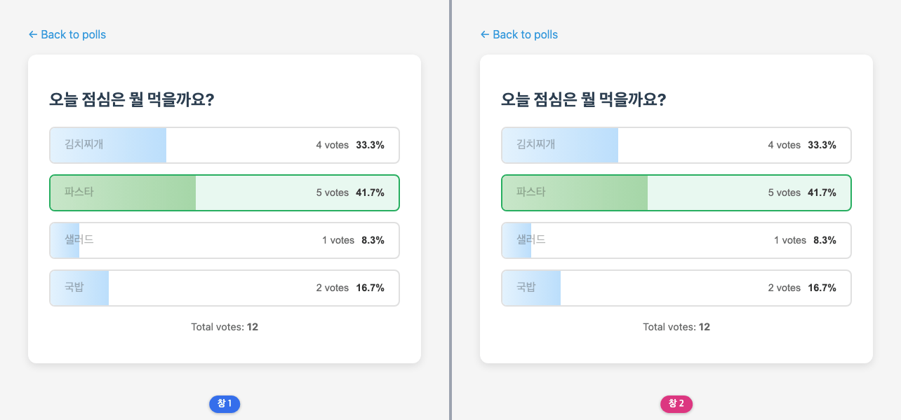 |
| [rating](./rating/) | 잠깐 쓰는 상태와 남는 상태를 갈라 둔다 | [Rating 앱](../docs/tutorials/11-rating-app.md) | 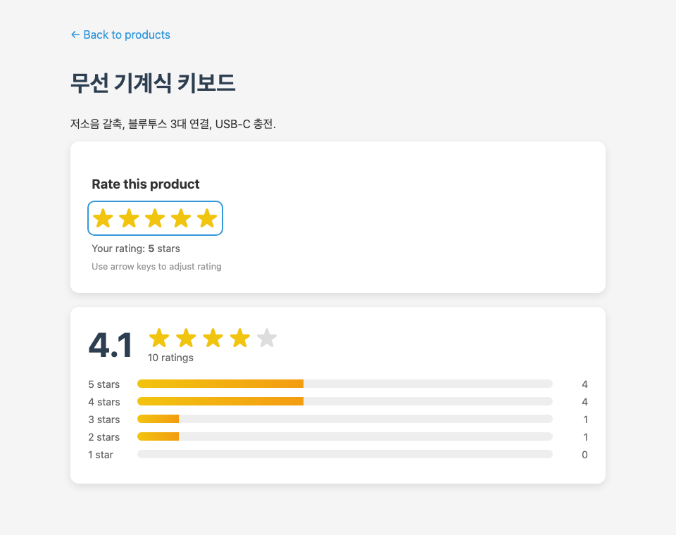 |
| [search](./search/) | 디바운스한 입력, 주소에 남는 검색어, 키보드로 고르는 결과 | [Live Search](../docs/tutorials/12-live-search.md) | 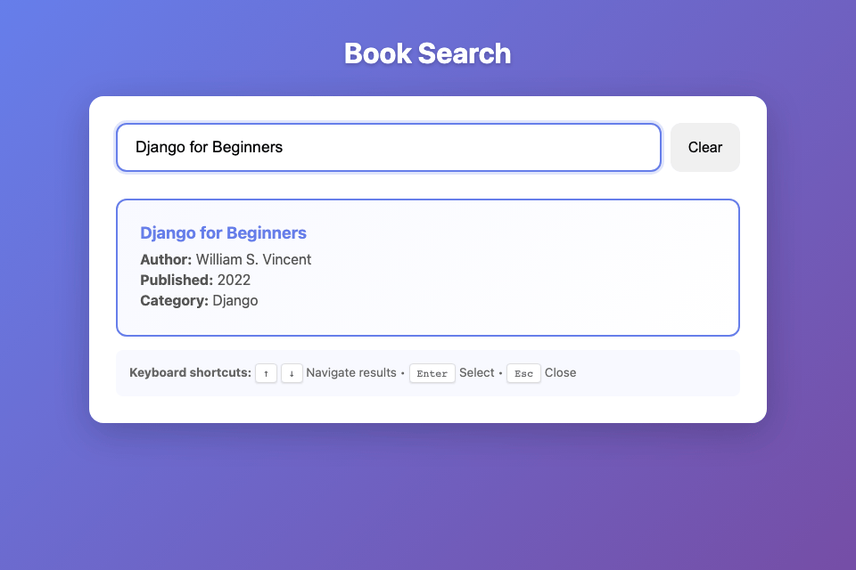 |
| [quiz](./quiz/) | 컴포넌트 상태로 굴리는 상태 머신 | [Quiz 앱](../docs/tutorials/13-quiz-app.md) | 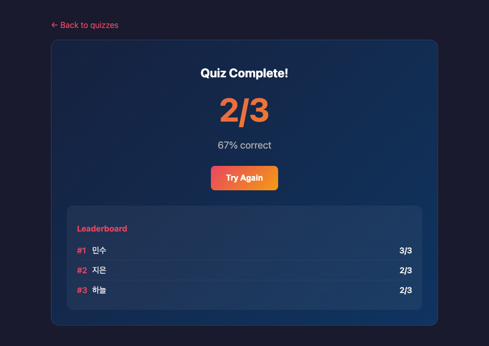 |
| [chat](./chat/) | Streams와 Presence | [Chat 앱](../docs/tutorials/04-chat-app.md) | 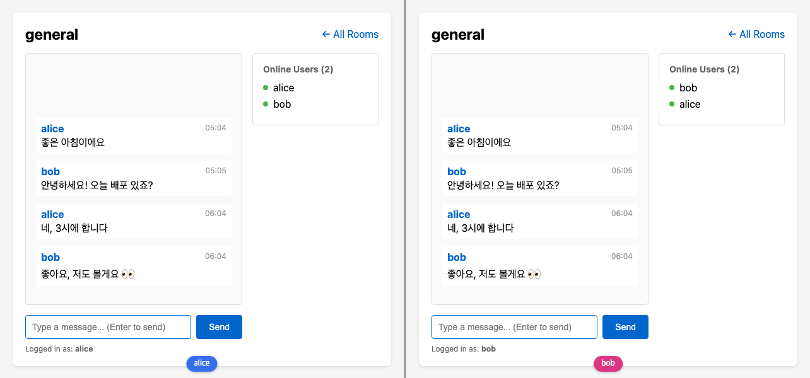 |
| [chat_lv2](./chat_lv2/) | chat 2단계: 누가 말하는가를 서버가 정한다 (로그인 사용자, 방 멤버십, `live_session`) | [기능 문서](../docs/features/live-session.md) | 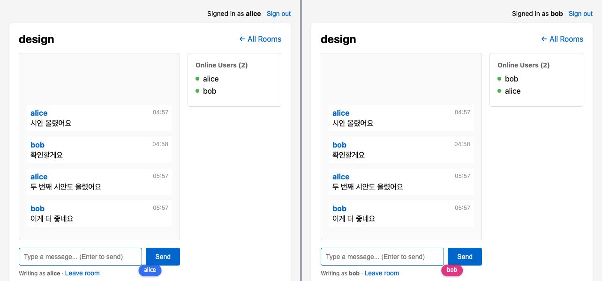 |
| [chat_lv3](./chat_lv3/) | chat 3단계: 스트림은 붙이기만 하는 목록이 아니다 (위로 스크롤해 과거 불러오기, 내 메시지 수정·삭제) | [Streams 심화](../docs/tutorials/06-streams-api.md) | 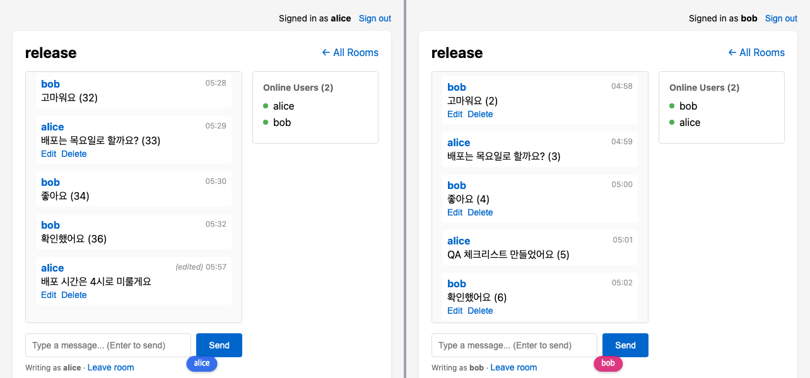 |
| [chat_lv4](./chat_lv4/) | chat 4단계: 한 사람에게만 가는 소식 (방 목록의 안 읽은 메시지 배지) | [Broadcast](../docs/features/broadcast.md) | 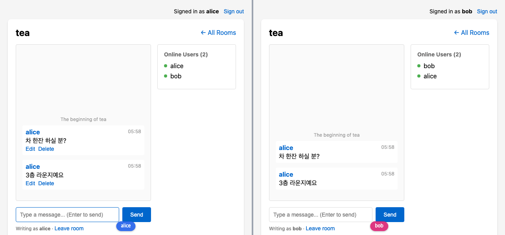 |
| [dashboard](./dashboard/) | AsyncResult로 느린 조회를 미룬다 | [Dashboard](../docs/tutorials/05-dashboard.md) | 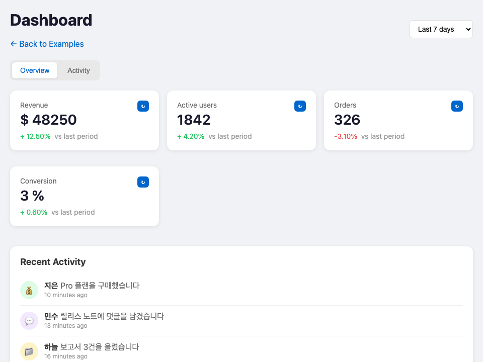 |
| [notifications](./notifications/) | 알림은 한 사용자에게 간다. 저장하는 알림과 저장하지 않는 토스트 | [Notifications](../docs/tutorials/14-notifications.md) | 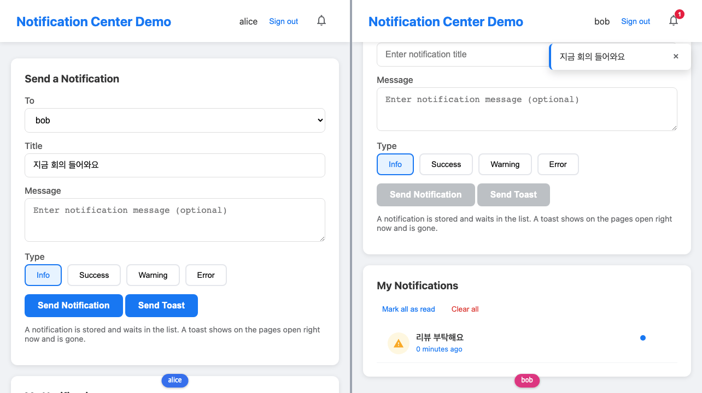 |
| [livecomp](./livecomp/) | 연결을 공유하는 중첩 컴포넌트 | [LiveComponent](../docs/tutorials/15-live-components.md) | 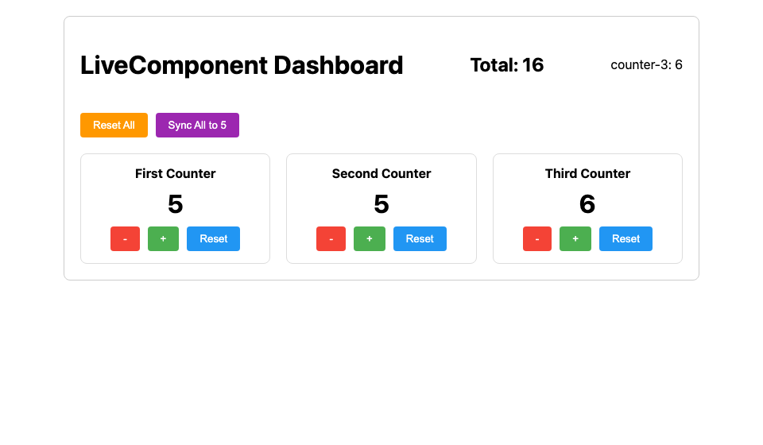 |
| [slots](./slots/) | 내용을 호출자가 채우는 레이아웃 컴포넌트 | [기능 문서](../docs/features/slots.md) | 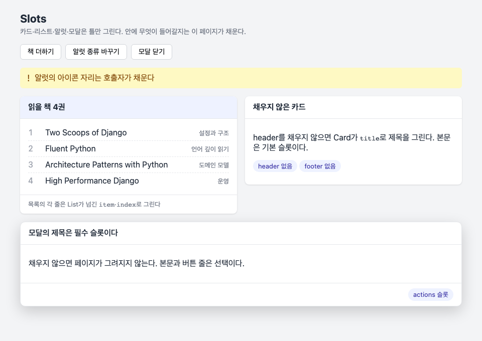 |
| [hooks](./hooks/) | 브라우저만 할 수 있는 일을 컴포넌트에 붙인다 | [기능 문서](../docs/features/hooks.md) | 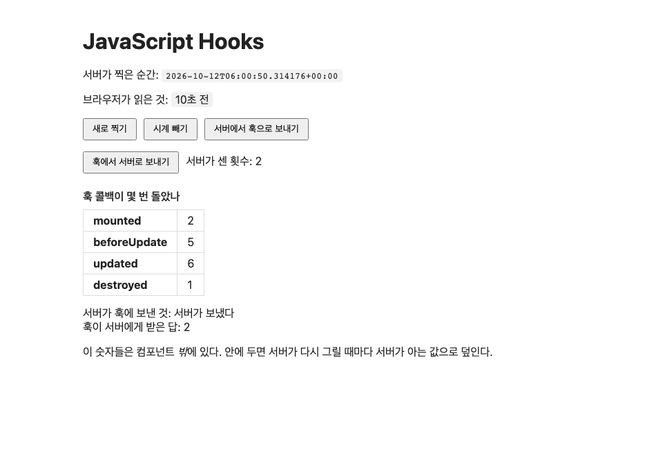 |

## 채팅 시리즈

`chat`에서 시작해 단계마다 개념 하나를 더한다. 단계마다 독립된 복사본이라 앞 단계를 import하지 않고,
각 README 맨 위에 앞 단계에서 바뀐 것과 `diff -r` 명령이 있다.

| 단계 | 더하는 것 | 핵심 |
|------|-----------|------|
| [chat](./chat/) | 방 하나의 실시간 채팅 | Streams, Broadcast, Presence |
| [chat_lv2](./chat_lv2/) | 누가 말하는가를 서버가 정한다 | 로그인 사용자, 방 멤버십, `live_session` 경계와 `on_mount` 훅, 나간 뒤 구독 놓기 |
| [chat_lv3](./chat_lv3/) | 스트림은 붙이기만 하는 목록이 아니다 | 커서로 과거 불러오기(`wire-viewport-top`, `stream(reset=False)`), 수정·삭제(`update_only`, `stream_delete`) |
| [chat_lv4](./chat_lv4/) | 한 사람에게만 가는 소식 | 읽은 자리 커서, 사용자마다의 토픽, 한 쿼리로 세는 안 읽은 수 |

## 화면과 동작 영상

예제마다 `media/` 에 마지막 화면(`<이름>.png`)과 장면을 녹화한 영상(`<이름>.webp`, 반복 재생되는 animated WebP)이
있다. 손으로 찍지 않는다 — 장면(사람이 하는 입력·클릭·스크롤)은 `scripts/example_media/scenes.py`에 데이터로 적혀 있고,
`make example-media`가 그것을 Chromium에서 돌려 녹화한다. 실시간 공유가 핵심인 예제(todo, poll, chat 시리즈, notifications)는
브라우저 컨텍스트 둘을 나란히 붙이고, 창마다 아래쪽에 누구의 화면인지 이름표를 단다.

### 다시 만드는 법

```bash
brew install ffmpeg webp pngquant              # ffmpeg, img2webp, pngquant (처음 한 번)
make example-media                             # 14개 전부, 7분쯤 걸린다
make example-media ARGS="--only chat_lv3"      # 일부만
uv run python -m scripts.example_media --list  # 장면마다 무엇을 보이는지
```

생성기는 빈 데이터베이스(`build/example-media/db.sqlite3`)에 장면의 시드를 넣고, E2E 하네스의 서버
(`tests/testproj/e2e_server.py`)를 장면마다 새로 띄운다. 뷰포트·로캘(ko-KR)·시간대·시드 데이터가 고정이라 다시 만들어도
같은 화면이 나온다 — 다만 그 자리에서 보낸 메시지의 시각처럼 지금 시각을 그리는 곳은 다르다. 예제의 화면을 바꿨으면
그 예제의 미디어를 다시 만들어 함께 커밋한다.

### 형식과 크기 예산

README는 GitHub, PyPI(루트 README), 문서 사이트(루트 README가 첫 페이지)에서 읽힌다. 셋 모두가 보여 주는 것은 이미지다 —
저장소에 둔 `.mp4`는 GitHub README에서 재생되지 않는다. 그래서 커밋하는 것은 PNG와 animated WebP 둘이고,
같은 장면의 MP4는 `build/example-media/`에만 만든다(데모 사이트가 같은 장면으로 다시 만든다).

| 파일 | 상한 | 만들 때의 실제 크기 |
|------|------|------|
| 마지막 화면 PNG (256색 팔레트) | 100KB | 11–46KB |
| 동작 영상 WebP (10fps, lossy) | 1MB | 134–711KB |
| 14개 예제 전부 | 6MB | 약 4.3MB |

상한은 `scripts/example_media/budget.py`에 있고, 넘으면 생성기가 실패하며 `tests/test_example_media.py`도 실패한다.
그 테스트는 예제마다 장면·두 파일이 있는지, README와 두 표가 그것을 가리키는지도 본다.
미디어 생성 자체는 브라우저가 필요해 `make test`에 들어가지 않는다.

## 예제는 테스트다

예제마다 `tests.py`가 있고 `make test`가 그것을 함께 돌린다. 릴리스 게이트(CI)도 태그마다 다시 돌리므로,
라이브러리가 바뀌어 예제가 깨지면 문서가 아니라 **테스트가** 먼저 알려 준다. 실제로 이
디렉터리로 옮기면서 테스트를 붙였을 때 네 개의 예제가 이미 고장 나 있었다.

예제는 `tests/`의 Django 프로젝트(`testproj`) 위에서 돈다. 설정과 URLconf는 거기에 있고,
여기에는 앱만 있다.

## 시작하기

미리 설치할 것은 [uv](https://docs.astral.sh/uv/) 하나와 git이다. Python과 Node는 uv가 저장소의 가상환경(`.venv`)에
넣는다 — Node는 dev 의존성 `nodejs-wheel`로 온다. 아래 명령은 Windows PowerShell·명령 프롬프트(cmd)와 macOS·Linux
터미널에서 **같은 한 줄**로 돈다. 그래서 `&&`(Windows PowerShell 5.1에 없다)나 `VAR=값 명령` 같은 셸 문법을 쓰지 않고,
`tests/`에서 돌아야 하는 명령은 `cd` 대신 `uv run --directory tests`로 부른다. 한 줄씩 붙여 넣는다.

### Windows에서 uv 설치

PowerShell에서 둘 중 하나:

```powershell
winget install --id=astral-sh.uv -e
```

```powershell
powershell -ExecutionPolicy ByPass -c "irm https://astral.sh/uv/install.ps1 | iex"
```

git이 없으면 `winget install --id=Git.Git -e`. **설치한 뒤에는 터미널을 새로 연다.** 열려 있던 창은 PATH가 바뀐 것을
모른다 — `uv`나 `git`을 찾지 못한다는 오류가 나면 이것이다. macOS·Linux의 설치는
[uv 설치 문서](https://docs.astral.sh/uv/getting-started/installation/)에 있다.

### 받고 준비하기 (처음 한 번)

```shell
git clone https://github.com/itda-work/django-wireview.git
cd django-wireview
uv sync --all-extras
uv run npm ci
uv run npm run build
uv run --directory tests python manage.py migrate
```

- `uv sync --all-extras` — Python, Django와 개발 도구, 그리고 Node·npm.
- `uv run npm ci` — JS 빌드 도구(esbuild). `npm warn allow-scripts … esbuild` 경고는 무시해도 된다. 빌드는 그 스크립트 없이 된다.
- `uv run npm run build` — `wireview.min.js`. 빌드 산출물이라 저장소에 없고, 없으면 페이지는 그려지지만 아무것도 반응하지 않는다.
  `wireview/static/wireview/wireview.js`를 고친 뒤에도 다시 한다.
- `... manage.py migrate` — 예제 모델의 테이블(`tests/db.sqlite3`). 빠뜨리면 chat 시리즈·poll·rating·quiz 페이지가 500이다.

Node를 이미 설치했어도 `npm`이 아니라 `uv run npm`으로 부른다. 그러면 `.venv`의 Node가 먼저 잡혀 누구나 같은 버전으로 빌드한다.

### 서버 띄우기

```shell
uv run --directory tests daphne testproj.asgi:application
```

브라우저에서 <http://localhost:8000/>가 예제 목록이다. 끌 때는 Ctrl+C. WebSocket이 필요하므로 `runserver`가 아니라
daphne로 띄운다.

### 테스트

```shell
uv run pytest tests examples -m "not e2e and not slow"
uv run pytest examples/quiz -m "not e2e"
```

첫 줄은 라이브러리와 예제 테스트 전부, 둘째 줄은 예제 하나다. 브라우저로 도는 테스트(todo, livecomp, hooks,
notifications, search, chat, chat_lv2, chat_lv3, chat_lv4, bookmarks)는 브라우저를 한 번 받은 뒤 `-m e2e`로 고른다:

```shell
uv run playwright install chromium
uv run pytest examples/todo -m e2e
```

### make가 있으면

macOS·Linux처럼 `make`가 있으면 같은 일을 줄여 쓸 수 있다. 정의는 저장소 루트의 `Makefile`이다.

| 위 명령 | make |
|---------|------|
| `uv sync --all-extras`, `uv run npm ci` | `make install` |
| `uv run npm run build` | `make build-js` |
| `uv run --directory tests python manage.py migrate` | `make migrate` |
| `uv run --directory tests daphne testproj.asgi:application` | `make run-daphne` |
| `uv run pytest tests examples -m "not e2e and not slow"` | `make test` (`ARGS="-k quiz"`로 좁힌다) |
| 브라우저 테스트 | `make test-e2e LAYER=memory` (JS 빌드와 브라우저 설치까지 한다) |

pytest를 직접 부를 때는 `-m "not e2e"`를 붙인다: `uv run pytest examples -m "not e2e"`.
빼면 브라우저 테스트(`e2e` 마커)가 섞여 들어오고, 그것들은 Playwright 브라우저를 미리 받아 두지 않으면
그냥 실패한다. `make test`는 이 마커를 이미 뺀다.
기본값(`addopts`)에 넣지 않은 것은 `pytest tests/test_csp_e2e.py`처럼 파일을 짚어 돌릴 때
전부 조용히 빠지기 때문이다.
