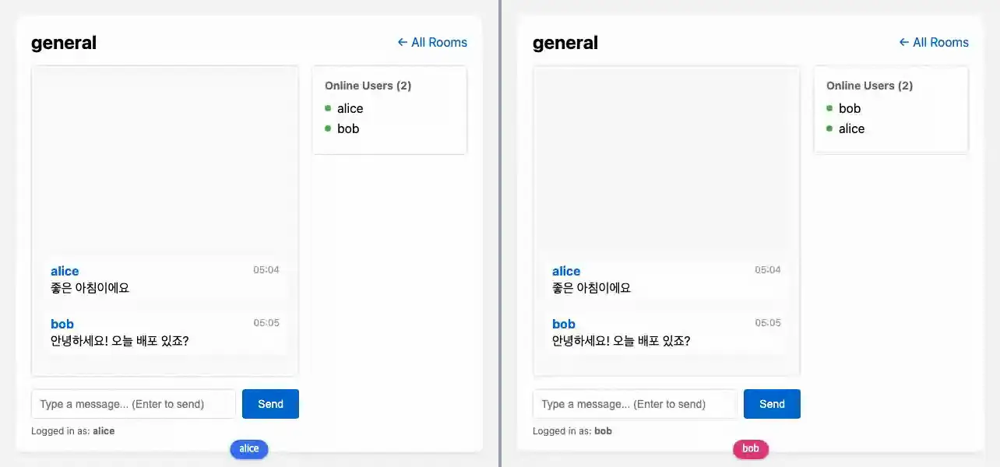

# chat

**Streams와 Presence — 큰 목록을 상태에 담지 않고, 누가 있는지 보여준다**



<sub>보낸 메시지는 Streams로 모든 창의 목록에 붙고, 누가 접속해 있는지·입력 중인지는 Presence가 알린다. 마지막 화면은 [media/chat.png](media/chat.png), 다시 만들려면 `make example-media ARGS="--only chat"`.</sub>

## 무엇을 보여주나

- `stream()`으로 메시지를 개별 렌더하고, 새 메시지는 `Broadcast`로 그 방의 모든 페이지에 넣는다 — 보내는 곳에서 한 번
  렌더하고, 받는 페이지에서는 코드가 돌지 않는다([Broadcast](../../docs/features/broadcast.md))
- 목록은 DOM에서 최신이 앞이고 `flex-direction: column-reverse`로 아래부터 그린다. 새 메시지를 `at=0`에 넣으면
  페이지마다 스크롤 명령 없이 맨 아래에 붙어 있다
- `PresenceMixin`, `PresenceTrackerMixin`으로 접속자·타이핑 표시. 한 페이지의 두 컴포넌트(`XChatRoom`이 알리고
  나중에 온 사람의 sync 요청에 답하며, `XOnlineUsers`가 보인다)는 한 사람으로 합쳐진다 — 같은 사람이 탭을 둘 열어도
  목록에는 한 번, 마지막 탭이 닫힐 때 빠진다
- 메시지 목록과 입력창을 분리해 구독 범위를 좁힌다

## 돌려보기

처음이면 [시작하기](../README.md#시작하기)를 먼저 따라 한다(uv 설치, 의존성, JS 빌드, migrate). 그 뒤로는 서버만 띄운다. WebSocket이 필요하므로 `runserver`가 아니라 daphne다.

```shell
uv run --directory tests daphne testproj.asgi:application
```

브라우저에서 <http://localhost:8000/chat/>.

```shell
uv run pytest examples/chat -m "not e2e"
uv run pytest examples/chat -m e2e
```

첫 줄은 브라우저 없이, 둘째 줄은 브라우저로 돈다. 브라우저 테스트는 [시작하기의 테스트](../README.md#테스트)에서 브라우저를 받은 뒤에 돈다.

테스트는 `examples/chat/tests.py`. `make test`가 함께 돌리고 릴리스 게이트(CI)가 태그마다 다시 돌리므로 이 예제는 조용히 낡지 않는다.

## 더 읽기

- 튜토리얼: [docs/tutorials/04-chat-app.md](../../docs/tutorials/04-chat-app.md)
- 핵심 파일: live.py · templates/chat/message_list_item.html (스트림 아이템)
- 다음 단계: [chat_lv2](../chat_lv2/) — 로그인 사용자, 방 멤버십, `live_session` 경계
