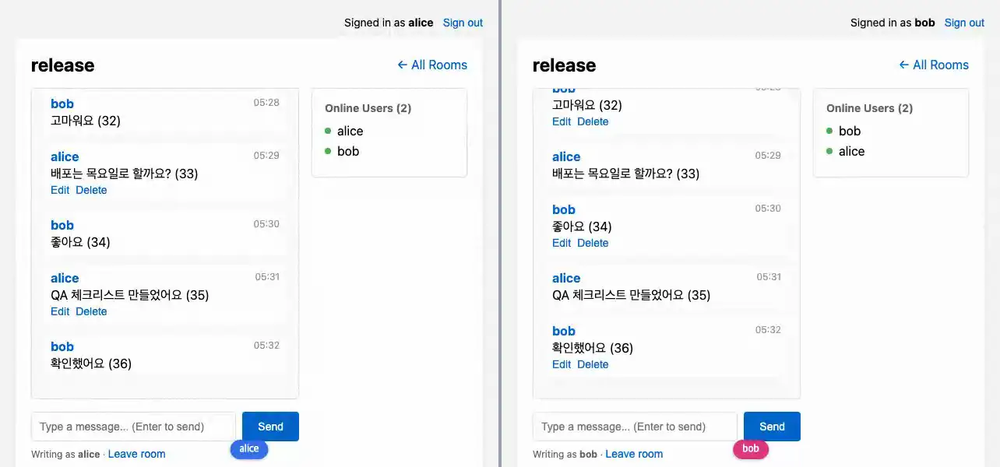

# chat_lv3

**스트림은 붙이기만 하는 목록이 아니다 — 위로 스크롤해 과거를 불러오고, 이미 그려진 메시지를 모든 페이지에서 고치고 지운다**



<sub>스트림은 붙이기만 하지 않는다: alice가 고친 메시지와 지운 메시지가 bob의 화면에서도 바뀌고, 위로 스크롤하면 과거를 불러온다. 마지막 화면은 [media/chat_lv3.png](media/chat_lv3.png), 다시 만들려면 `make example-media ARGS="--only chat_lv3"`.</sub>

채팅 예제 시리즈의 셋째 단계다([#197](https://github.com/itda-work/django-wireview/issues/197)).
[chat_lv2](../chat_lv2/)의 목록은 최근 50개를 한 번 그리고 새 메시지를 아래에 붙이기만 했다. 그보다 오래된 메시지는
볼 길이 없었고, 한 번 보낸 메시지는 고칠 수도 지울 수도 없었다. 여기서는 그 둘을 더한다. 누가 말하는가와 누가
방에 있는가는 chat_lv2 그대로다 — 새 핸들러도 같은 `is_member()`를 다시 묻는다.

## chat_lv2에서 바뀐 것

- 목록은 최근 30개(`PAGE_SIZE`)로 연다. 위로 스크롤해 가장 오래된 메시지 위의 표시가 보이면(`wire-viewport-top`)
  그 이전 30개를 불러와 위에 붙인다. 방의 첫 메시지에 닿으면 "The beginning of …"를 보이고 멈춘다
- 어디까지 불러왔는가(커서)는 `Lv3MessageList`의 서명 상태에 있다: 가장 오래된 메시지의 `oldest_at`·`oldest_id`와
  끝에 닿았는지(`reached_start`)
- 내 메시지에만 Edit·Delete 버튼이 보인다. 수정하면 그 방의 모든 페이지에서 같은 자리의 메시지가 바뀌고
  "(edited)"가 붙는다. 삭제하면 모든 페이지에서 사라진다
- `Message`에 `edited_at`과 과거 읽기용 인덱스(`room, -created_at, -id`)
- 컴포넌트 이름(`Lv3ChatRoom`, `Lv3MessageList`, `Lv3OnlineUsers`), 앱 label, 템플릿 디렉터리(`chat_lv3/`),
  URL(`/chat-lv3/`, namespace `chat_lv3`), live_session 이름(`chat_lv3`), 토픽 접두사(`chat_lv3.`)가 chat_lv2와 겹치지 않는다

전체 차이는 저장소 루트에서 이렇게 본다.

```bash
diff -r -x __pycache__ -x '*.pyi' examples/chat_lv2 examples/chat_lv3
```

## 무엇을 보여주나

**과거는 커서로 한 페이지씩 읽는다.** `joined()`는 최근 30개를 `stream()`으로 보내고, 그 가운데 가장 오래된
메시지를 커서로 기억한다. `load_older()`는 "커서보다 오래된 30개"를 읽어 `stream(..., at=-1, reset=False)`로
한 번에 붙이고 커서를 옮긴다 — 화면의 목록을 두고 30개를 연산 하나(프레임 하나)로, 읽은 순서 그대로 넣는다. 목록은 DOM에서 최신이 먼저이고 `flex-direction: column-reverse`로 아래에서 위로 그려지므로, DOM의
끝(`at=-1`)이 화면의 맨 위다. 새 메시지는 그대로 `at=0`(화면 맨 아래)이다.

- **커서는 시각과 id의 쌍이다.** 두 메시지가 같은 `created_at`을 가질 수 있으므로 "더 오래된"은
  `(created_at, id)`를 목록의 정렬 그대로 비교한다. 시각만 쓰면 커서와 같은 시각의 메시지가 빠지거나(`<`)
  두 번 나온다(`<=`). 같은 이유로 오프셋(`[30:60]`)도 쓰지 않는다 — 그 사이에 새 메시지가 오면 한 칸씩 밀린다.
- **끝은 한 행을 더 읽어 안다.** 31개를 읽어 30개만 보이고, 31번째가 없으면 끝이다. 그래서 정확히 30개인 방도
  빈 페이지를 한 번 더 부르지 않고 바로 "The beginning"을 보인다.
- **방은 쿼리의 것이다.** 커서는 서명 상태라 브라우저가 바꿀 수 없다(바꾼 상태는 join되지 않는다). 그래도
  `_history()`는 커서가 무엇을 말하든 `room=self.room`으로 거른다. 커서는 이 방의 역사 안의 자리일 뿐이다.
- **쿼리는 `stream()`이 읽는다.** `load_older()`는 페이지를 리스트로 미리 읽지 않고 쿼리를 감싼 async 반복자
  (`_page_of`)를 넘긴다. `stream()`은 읽기 전부터 이 목록의 Broadcast 패치를 잡아 두고 페이지가 나간 뒤에 쓴다. 미리
  읽으면 그 사이에 다른 멤버가 지운 메시지의 delete가 페이지보다 먼저 쓰여, 지운 메시지가 페이지와 함께 되살아난다
  ([Broadcast — 순서와 유실](../../docs/features/broadcast.md#순서와-유실)).
- **join마다 처음부터.** 재연결이나 새로고침의 `joined()`는 `stream()` reset으로 다시 최근 30개를 보낸다. 불러온
  과거는 그때 사라지고 커서도 처음으로 돌아간다.

**수정은 같은 DOM id로, 보이는 곳에서만.** 수정한 메시지는 `Broadcast(...).stream_insert(..., update_only=True)`로
그 방의 모든 목록에 간다. DOM id가 같으므로 그 메시지를 보이는 페이지는 제자리에서 바꾼다. 삭제는
`stream_delete`다. 둘 다 [Broadcast](../../docs/features/broadcast.md)라 항목은 발행하는 곳에서 한 번 렌더된다.

`update_only=True`가 필요한 이유는 페이지마다 불러온 범위가 다르기 때문이다. alice가 방의 첫 메시지까지 스크롤해
그것을 고쳤을 때, 최근 30개만 본 bob의 페이지에는 그 메시지가 없다. 보통의 `stream_insert`는 없는 id를 `at`
자리(맨 아래)에 넣는다 — bob의 화면 맨 아래에 가장 오래된 메시지가 나타나고, 나중에 bob이 거기까지 스크롤하면
순서가 어긋난다. `update_only`는 그 페이지에서 아무것도 하지 않는다. bob이 나중에 그 자리까지 불러오면 DB에서
고쳐진 판을 읽는다.

**버튼은 보는 사람의 것, 판정은 서버의 것.** 항목은 모든 구독자에게 같은 HTML로 가므로 항목 템플릿은 "이것이
보는 사람의 메시지인가"를 알 수 없다(`user`를 읽으면 Broadcast가 오류를 낸다). 그래서 항목은 작성자 id를
`data-author`로 싣고, 목록 컴포넌트의 템플릿(그 렌더는 보는 사람마다 따로다)이 자기 사용자의 id로 고른 스타일을
둔다. 버튼을 감추는 것은 화면의 일이고, 막는 것은 서버다. 이벤트는 아무 메시지 id나 보낼 수 있으므로 핸들러가
`_own_message()`로 "이 방의 메시지이고, 작성자가 `self.user`이고, 아직 멤버인가"를 다시 묻는다. 저장할 때도
편집기를 연 메시지를 믿지 않고 다시 묻는다.

- `data-author`에는 작성자의 pk가 실린다. 그 HTML을 받는 사람은 같은 방의 멤버뿐이고 그들은 이미 작성자 이름을
  본다. pk가 더하는 것은 순차 정수 id(가입 순서·규모를 짐작할 단서)뿐이다. 그것도 감추려면 pk 대신 공개해도 되는
  값(작성자별 무작위 토큰 등)을 싣는다.
- 버튼을 고르는 스타일은 목록 템플릿의 인라인 `<style>`이다. `'unsafe-inline'` 없는 `style-src` CSP에서는
  nonce가 없어 막히고, 그러면 버튼이 안 보이는 쪽으로 실패한다(서버의 판정은 그대로다). 이 시리즈의 `style=` 속성과
  `base.html`의 `<style>`도 같은 처지다. 엄격한 CSP를 쓰는 앱은 이 규칙을 정적 CSS로 옮긴다.

| 어디서 | 무엇이 거절하나 | 거절의 모양 |
|------|------|------|
| 이전 메시지 불러오기, 멤버 아님 | `load_older`의 `is_member()` | 불러오지 않는다 |
| 이전 메시지 불러오기, 이미 끝 | `load_older`의 `reached_start` | 쿼리도 하지 않는다 |
| 남의 메시지 수정·삭제 (멤버) | `_own_message()`의 작성자 조건 | 아무것도 바꾸지 않고 아무에게도 보내지 않는다 |
| 내 메시지 수정·삭제, 멤버십이 끝남 | `_own_message()`의 `is_member()` | 같다 |
| 방을 나간 사용자의 열린 페이지 | chat_lv2의 멤버십 알림 | 방 토픽 구독을 놓았으므로 수정·삭제 패치도 오지 않는다 |

거절은 조용하다. 정상 화면에는 남의 메시지에 버튼이 없으므로 여기에 닿는 것은 손으로 만든 이벤트이거나 다른
탭에서 방금 나간 경우뿐이다. 알려 줄 사람이 없거나 곧 방 목록으로 간다. chat_lv2의 `send_message`가 멤버가
아닐 때 쓰지 않고 넘어가는 것과 같은 모양이고, 예외를 던지면 그 컴포넌트가 이벤트 전 상태로 다시 join할 뿐이다
([서버 오류 처리](../../docs/features/errors.md)).

**삭제는 행을 지운다.** 답글이나 인용이 없으므로 지운 자리를 남길 이유가 없다. 지운 메시지가 어떤 페이지의
커서였어도 괜찮다 — 커서는 행을 가리키지 않고 `(시각, id)`라는 자리를 말하므로, 그보다 오래된 것을 읽는 쿼리는
그대로다.

**편집 중인 입력은 다른 렌더가 지우지 않는다.** 편집기는 목록 컴포넌트의 상태(`editing`, `draft`)로 그린다.
편집하는 동안 위로 스크롤해 과거를 불러오면 커서가 바뀌어 목록이 다시 렌더되고, 서버의 HTML에는 편집을
시작했을 때의 `draft`가 있다. 페이지는 사용자가 고친 칸의 값을 그 렌더로 덮지 않는다
([폼 피드백](../../docs/features/form-feedback.md)의 입력값 규칙). 저장(Enter)에 답하는 렌더만 그 칸을 닫는다.
E2E가 이 순서를 그대로 밟는다.

### 스트림 limit을 쓰지 않는 이유

`stream_insert(..., limit=N)`은 넘친 항목을 넣은 쪽의 반대 끝에서 지운다. 새 메시지(`at=0`)에 limit을 걸면,
과거를 불러온 페이지에 새 메시지가 올 때마다 화면 맨 위의 가장 오래된 메시지가 잘린다. 그러면 커서는 잘린
메시지보다 더 오래된 곳을 가리키므로, 사용자가 다시 위로 스크롤하면 잘린 구간을 건너뛰고 그 너머를 불러온다 —
목록에 구멍이 생긴다. 과거를 불러오는 쪽(`at=-1`)에 limit을 걸면 이번에는 최신 메시지가 잘린다. 그래서 이
예제는 limit을 쓰지 않는다. 오래 열어 둔 페이지의 목록은 불러온 만큼 커지고, 새로고침하면 다시 30개로 시작한다.
limit이 필요하다면 잘린 쪽의 커서도 함께 옮겨야 한다(잘린 끝에 닿으면 다시 불러오는 양방향 창) — 이 단계의
범위 밖이다.

### 라이브러리에서 바뀐 것

이 예제를 만들며 라이브러리 두 곳을 고쳤다.

- `Component.stream_insert`와 `Broadcast.stream_insert`의 `update_only=True`(Phoenix LiveView의 `update_only`와 같다).
  위의 "수정은 보이는 곳에서만"이 이것이다. 이 필드를 모르는 옛 JS는 없는 항목을 넣어 버리므로, 서버는 프로토콜
  버전 9 미만의 페이지에 그 연산을 보내지 않는다. 롤링 배포 중 옛 JS로 열린 페이지는 다시 join할 때까지 고치기 전
  내용을 보인다([wire-protocol §7](../../docs/implementation/wire-protocol.md#7-버전)).
- `stream(..., reset=False)`: 화면의 것을 두고 여러 항목을 `at`에 한 연산으로 넣는다. `load_older()`가 쓴다.
  전에는 `stream_insert`를 항목마다 불러 한 페이지가 프레임 30개였다.
- `wire-viewport-top`·`wire-viewport-bottom`은 스크롤 방향을 창(`window.scrollY`)에서만 쟀다. 이 목록처럼 자기
  스크롤바가 있는 상자 안에서는 창이 움직이지 않으므로 위로 스크롤해도 아무것도 불리지 않았다. 이제 그 요소를
  움직일 수 있는 스크롤(스크롤하는 조상들과 창) 중 하나라도 그쪽으로 움직였으면 부르고, "지나침"은 실제로 넘치는
  가장 가까운 상자에서 잰다(`static/wireview/viewport.mjs`).

**한계.** chat_lv2의 한계(알림이 닿아야 끊긴다)가 수정·삭제 패치에도 그대로다. 방을 나간 뒤 열린 페이지가
멤버십 알림을 처리하기 전의 짧은 창에는 수정·삭제가 아직 닿을 수 있다. 끊긴 동안의 수정·삭제는 다음 join의
`joined()`가 다시 읽어 바로잡는다 — Broadcast는 최대 한 번이다.

## 돌려보기

처음이면 [시작하기](../README.md#시작하기)를 먼저 따라 한다(uv 설치, 의존성, JS 빌드, migrate). 그 뒤로는 서버만 띄운다. WebSocket이 필요하므로 `runserver`가 아니라 daphne다.

```shell
uv run --directory tests daphne testproj.asgi:application
```

브라우저에서 <http://localhost:8000/chat-lv3/>를 열고 alice로 로그인해 방을 만든다. 시크릿 창에서 같은 주소를
열고 bob으로 로그인해 Join한다. 메시지를 30개 넘게 보낸 뒤 새로고침하면 목록 위쪽에 "Loading older messages..."가
있고, 위로 스크롤하면 이전 메시지가 붙는다. alice가 자기 메시지의 Edit·Delete를 누르면 bob의 창에도 반영된다.

```shell
uv run pytest examples/chat_lv3 -m "not e2e"
uv run pytest examples/chat_lv3 -m e2e
```

첫 줄은 브라우저 없이, 둘째 줄은 브라우저로 돈다. 브라우저 테스트는 [시작하기의 테스트](../README.md#테스트)에서 브라우저를 받은 뒤에 돈다.

테스트는 `examples/chat_lv3/tests.py`. 과거 읽기는 페이지 경계, 같은 시각의 메시지, 끝, 다른 방을 가리키는
커서, 읽는 동안 지우거나 고친 메시지를 보고, 수정·삭제는 작성자·비작성자·나간 사용자와, 나간 사용자가 열어 둔 실제 소켓에 패치가 오지
않는지를 본다. E2E는 브라우저 둘이 각자 스크롤하며 수정·삭제를 주고받는다. `make test`가 함께 돌리고 릴리스
게이트(CI)가 태그마다 다시 돌리므로 이 예제는 조용히 낡지 않는다.

## 더 읽기

- 이전 단계: [chat_lv2](../chat_lv2/) — 로그인 사용자, 방 멤버십, `live_session` 경계
- 다음 단계: [chat_lv4](../chat_lv4/) — 방 목록의 안 읽은 메시지 배지(한 사용자에게만 가는 소식)
- 스트림과 무한 스크롤: [Streams 튜토리얼](../../docs/tutorials/06-streams-api.md), 렌더 없는 발행: [Broadcast](../../docs/features/broadcast.md)
- 핵심 파일: live.py(`_history`, `Lv3MessageList`) · templates/chat_lv3/message_list.html · message_list_item.html
