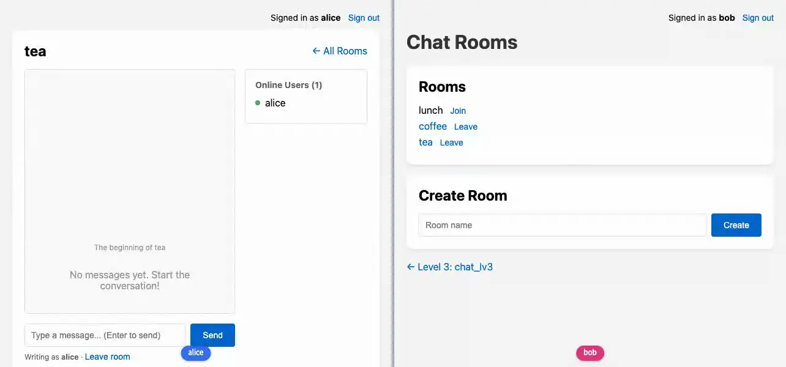

# chat_lv4

**새 메시지는 방의 모든 페이지에 같은 패치로 가지만, 안 읽은 수는 사람마다 다르다 — 그 소식은 한 사람의 토픽으로 간다**



<sub>bob이 보지 않는 방에 alice가 말하면 bob의 방 목록에만 안 읽은 수가 오르고, 방을 열면 사라진다. 마지막 화면은 [media/chat_lv4.png](media/chat_lv4.png), 다시 만들려면 `make example-media ARGS="--only chat_lv4"`.</sub>

채팅 예제 시리즈의 넷째이자 마지막 단계다([#197](https://github.com/itda-work/django-wireview/issues/197)).
[chat_lv3](../chat_lv3/)까지 방 목록은 이름과 Join·Leave뿐이었다. 다른 방에 새 메시지가 와도 들어가 보기 전에는
알 길이 없었다. 여기서는 방 목록의 방마다 **안 읽은 메시지 수**를 띄운다. 새 메시지는 그 방을 보고 있지 않은
멤버의 배지만 올리고, 방을 열면 0이 된다. 누가 말하는가, 누가 방에 있는가, 과거 읽기와 수정·삭제는 chat_lv3 그대로다.

## chat_lv3에서 바뀐 것

- `Membership`에 마지막으로 읽은 자리 `read_at`·`read_id`. 목록의 커서와 같은 `(created_at, id)`다
- 방 목록이 컴포넌트(`Lv4RoomList`)다. 방마다 안 읽은 수를 배지로 보이고, 열어 둔 동안 바뀐다. Join·Leave는 chat_lv3처럼
  뷰 `join_room`·`leave_room`에 보내는 POST 폼이고, 이제 그 컴포넌트 안에 있다. 1.6부터 컴포넌트 템플릿의
  ``이 라이브 렌더에서도 토큰을 그리므로([#206](https://github.com/itda-work/django-wireview/issues/206))
  배지 때문에 다시 그려진 폼도 그대로 통과한다. 폼에는 `wire-boost`를 달았다
- 방 목록 페이지에도 경계가 있다: 정책 없는 live_session `chat_lv4_rooms`. 로그아웃이 열린 목록의 소켓을 닫게 하려는 것이다
- 사용자마다 토픽 하나: `chat_lv4.user.<pk>`. 새 메시지와 삭제는 보낸 사람을 뺀 멤버 각자의 토픽에, 읽음·Join·Leave는
  그 사용자 자신의 토픽에 알린다(`user_topic`, `tell_members`)
- `Lv4MessageList`가 읽음을 기록한다: `joined()`에서, 그리고 자기 사용자 토픽이 "이 방에 새 메시지"라고 할 때(`_mark_read`).
  방을 나가면 방 토픽과 함께 사용자 토픽도 놓는다
- 안 읽은 수는 집계 쿼리 하나로 센다(`unread_counts`). 커서 뒤의 메시지만 읽는다
- 컴포넌트 이름(`Lv4*`), 앱 label, 템플릿 디렉터리(`chat_lv4/`), URL(`/chat-lv4/`, namespace `chat_lv4`),
  live_session 이름(`chat_lv4`), 토픽 접두사(`chat_lv4.`)가 chat_lv3와 겹치지 않는다

전체 차이는 저장소 루트에서 이렇게 본다.

```bash
diff -r -x __pycache__ -x '*.pyi' examples/chat_lv3 examples/chat_lv4
```

## 무엇을 보여주나

### 안 읽은 수: 한 사람에게만 가는 소식

새 메시지 자체는 chat_lv3처럼 [Broadcast](../../docs/features/broadcast.md)다. 발행하는 곳에서 한 번 렌더되어 그 방을
열어 둔 모든 페이지에 같은 바이트로 간다. 받는 쪽에서는 코드가 돌지 않는다. 배지는 그렇게 보낼 수 없다. bob의
lobby 배지는 3이고 carol의 것은 0일 수 있다 — 같은 메시지가 사람마다 다른 수를 바꾼다. 그래서 배지의 소식은
**사용자마다의 토픽**으로 간다. 그 토픽은 그 사용자의 컴포넌트만 구독하므로, 거기 보낸 것은 다른 사람의 페이지에
닿지 않는다([notifications](../notifications/)의 사용자별 채널과 같다).

**누구에게 무엇이 가는가.**

| 일 | 무엇이 | 누구에게 | 받은 쪽이 하는 일 |
|------|------|------|------|
| 새 메시지 | Broadcast `stream_insert` | 방 토픽: 그 방을 열어 둔 모든 목록 | 아무 코드도 돌지 않는다. 목록에 붙는다 |
| 새 메시지 | 알림 `event="message"` | 보낸 사람을 뺀 **지금의** 멤버 각자의 사용자 토픽 | 방 목록은 다시 센다. 그 방을 열어 둔 페이지는 읽음으로 기록한다 |
| 읽음 | 알림 `event="read"` (커서가 실제로 움직였을 때만) | 읽은 사람 자신의 토픽 | 그 사람의 다른 탭의 방 목록이 다시 센다 |
| 삭제 | Broadcast `stream_delete` + 알림 `event="deleted"` | 방 토픽 + 지운 사람을 뺀 멤버 각자의 토픽 | 목록에서 빠지고, 방 목록이 다시 센다 |
| 수정 | Broadcast `stream_insert(update_only=True)`만 | 방 토픽 | 수는 그대로다 — 고친 메시지도 한 개다 |
| Leave | 멤버십 알림 + 알림 `event="left"` | 나간 사람 자신의 토픽들 | 열린 방 페이지는 그 방의 토픽과 사용자 토픽을 놓고, 방 목록은 그 방의 배지를 지운다 |
| Join | 알림 `event="joined"` | 들어간 사람 자신의 토픽 | 방 목록이 링크와 배지를 그린다 |

**알림은 수를 싣지 않는다.** 알림이 말하는 것은 "어느 방에 무슨 일이 있었다"뿐이고, 받은 방 목록은 DB에 다시
묻는다. 수를 실으면 받는 사람마다 다른 알림을 만들어야 하고, 알림은 늦거나 서로 엇갈려 도착할 수 있다 — 읽음
알림이 새 메시지 알림보다 먼저 닿으면 "+1"을 더하는 목록은 틀린 수에 머문다. 다시 세면 마지막에 처리한 알림이
무엇이든 그때의 DB가 답이다. 진실은 커서와 메시지 행에 있다.

**읽음 판정.** 커서는 그 멤버가 본 가장 새 메시지의 `(created_at, id)`다. 안 읽은 메시지는 커서보다 뒤에 있고
자기가 쓰지 않은 그 방의 메시지다. "뒤"는 chat_lv3의 과거 읽기와 같은 규칙으로 쌍을 비교한다 — 같은 시각의
메시지가 빠지거나(`>`) 두 번 세어지지(`>=`) 않는다. 처음 열기 전(커서 없음)에는 남이 쓴 모든 메시지가 안 읽은 것이다.

- **열어 둔 방 페이지가 읽는다.** `Lv4MessageList`는 `joined()`에서 방의 가장 새 메시지까지 읽음으로 기록한다.
  열어 둔 동안 사용자 토픽이 "이 방에 새 메시지"라고 하면 다시 기록한다. 다른 방의 소식은 지나친다.
- **앞으로만.** 기록은 "커서가 지금 그 자리보다 앞일 때만" 고치는 조건부 UPDATE다. 늦게 join한 탭이 커서를
  되돌리지 못하고, 아무것도 움직이지 않았으면 읽음 알림도 내지 않는다.
- **자기 멤버십만.** UPDATE는 그 사용자의 그 방 멤버십 행만 고른다. 나간 사용자의 페이지는 고칠 행이 없다.
- **커서는 행이 아니라 자리다.** 커서가 가리키던 메시지를 지워도 비교는 그대로다. 안 읽은 메시지를 지우면
  다음에 셀 때 하나 줄어든다. 수는 언제나 DB에서 세므로 삭제가 따로 고칠 숫자가 없다.

**숨긴 탭도 읽은 것으로 친다.** 이 예제는 "방 페이지가 열려 있다"를 "읽었다"로 본다. 그 탭이 뒤에 숨어 있거나
창이 최소화되어 있어도, 위로 스크롤해 과거를 보고 있어도 새 메시지는 읽은 것이 되고 다른 탭의 배지는 오르지
않는다. 단순함을 위해 고른 판정이고, 실제 앱에서는 틀린 답일 때가 많다. 고치려면 방 페이지에 훅을 달아
`visibilitychange`에서 `pushEvent`로 보임·숨김을 알리고, `_mark_read()`를 보일 때만 하고, 다시 보이게 될 때 한
번 한다. 서버가 판단을 들고 있으므로 고칠 곳은 그 둘이다.

**센다: 쿼리 하나로, 커서 뒤만.** `unread_counts()`는 사용자의 멤버십을 메시지에 붙여 방별로 `COUNT`하는 집계 쿼리
하나다. 방이 다섯이든 하나든 같다(방 목록 자체를 읽는 쿼리가 하나 더 있다). 멤버십 조건(누구의 것인가, 커서)은
한 `filter()` 안에 둔다 — 나눠 쓰면 Django가 멤버십을 두 번 조인해, 다른 멤버의 커서로 세게 된다.

쿼리 수만이 아니라 읽는 행도 본다. 새 메시지 하나가 멤버마다 목록을 다시 세게 하므로, 세기가 방의 역사 전체를
훑으면 비용이 멤버 수 × 역사 길이로 자란다. 커서 조건을 "커서가 없거나, 더 늦거나, 같은 시각에 id가 크다"는 OR
하나로 쓰면 맞기는 하지만 인덱스의 범위가 되지 못한다 — SQLite의 계획은 그 방의 메시지를 `room_id`로 전부 읽고
거른다. 그래서 조건을 둘로 나눈다. `created_at >= COALESCE(read_at, 가장 이른 시각)`이 chat_lv3가 만든
`(room, created_at, id)` 인덱스의 범위가 되어 커서 뒤만 읽고, 쌍의 나머지(같은 시각이면 id가 큰가)는 그 행들에서
거른다. 커서가 없으면 `COALESCE`가 가장 이른 시각을 주므로 모든 메시지가 범위에 든다. SQLite에서 계획이
`USING INDEX chat_lv4_history (room_id=? AND created_at>?)`인지는 테스트가 본다. 다른 DB는 계획을 따로 세우므로 그 DB의
`EXPLAIN`으로 확인한다. 쿼리가 주는 것(인덱스에 걸 수 있는 하한)은 같다.

**여러 탭.** bob이 한 탭에서 tea를 보고 다른 탭에서 방 목록을 볼 때, alice가 tea에 쓰면 목록 탭은 두 알림을 받는다.
alice의 새 메시지 알림과, tea 탭이 그것을 읽었다는 알림이다. 목록 탭이 첫 알림을 tea 탭의 기록보다 먼저 처리하면
배지가 잠깐 1을 보이고, 읽음 알림을 처리하면 0으로 돌아간다. 둘이 다 처리된 뒤에는 언제나 0이다. 깜빡임까지
없애려면 보내는 쪽이 "지금 그 방을 보는 사람"을 알아야 하는데, 그것은 연결이 끊길 때 지워지지 않을 수 있는 상태다.
이 예제는 그 상태를 두지 않는다.

**방 목록은 컴포넌트이고 Join·Leave는 그 안의 폼이다.** 배지가 바뀌려면 목록이 다시 렌더되어야 하므로 목록은
컴포넌트다. Join·Leave는 chat_lv3의 뷰와 같은 POST 폼이고, 목록의 템플릿(`room_list.html`)이 방마다 그린다. Join 뷰는
멤버십을 만들고 그 사용자의 토픽에 `joined`를 알린 뒤 방으로 보낸다. Leave 뷰는 `end_membership()`을 부르고 목록으로
보낸다(post/redirect/get). 둘 다 `wire-boost`라 Leave는 페이지를 다시 받지 않고 같은 소켓으로 목록에 돌아오고, Join은
방 페이지가 다른 live_session이므로 전체 로드로 넘어간다([boost](../../docs/features/boost.md)). 알림은 `broadcast()`라
요청의 트랜잭션(`ATOMIC_REQUESTS`)이 커밋된 뒤 나간다 — 다시 세는 목록이 새 멤버십을 본다.

**라이브 렌더 뒤의 폼도 토큰을 가진다.** 목록은 열어 둔 동안 배지 소식마다 서버에서 다시 그려지고, 그 렌더에는
HTTP 요청이 없다. 1.5까지는 그 렌더의 ``이 빈 값이라 다시 그려진 폼이 403을 받았고, 이 예제는 한때
Join·Leave를 이벤트로 옮겨 피했다. 1.6부터 라이브 렌더는 그 연결의 CSRF 시크릿으로 토큰을 그린다
([#206](https://github.com/itda-work/django-wireview/issues/206)). E2E가 alice의 메시지로 배지가 오른 뒤의 목록에서
Join·Leave를 눌러 응답이 403이 아닌지 본다.

**이벤트로 해도 되지 않나.** 된다 — ``와 핸들러 하나면 페이지를 다시 받지
않고 목록이 그 자리에서 바뀐다. 차이는 누가 인증을 묻느냐다. 폼은 POST마다 뷰가 `request.user`를 읽으므로, 다른
탭에서 로그아웃한 뒤 누른 Join은 익명이라 아무것도 하지 않는다. 소켓 이벤트는 connect 때의 사용자로 실행된다 —
어느 경계에도 들지 않은 연결은 로그아웃을 듣지 않으므로, 열어 둔 탭이 로그아웃한 사람으로 방에 들어가고 나갈
수 있다. 이벤트를 고른다면 그 페이지를 경계 안에 두어 로그아웃이 소켓을 닫게 해야 하고, 그 발행도 최선 노력이다
([로그아웃과 기존 연결](../../docs/features/live-session.md#로그아웃과-기존-연결)). 뷰를 이벤트로 옮길 때는 언제나 같은
질문을 한다: 그 뷰가 요청마다 묻던 것을 이제 누가 묻는가. 이 예제는 묻는 자리를 뷰에 그대로 둔다.

**그래도 목록 페이지는 경계 안에 있다.** 폼이 요청마다 인증을 다시 봐도, 열어 둔 목록의 소켓은 connect 때의
사용자 토픽을 듣는다. 경계 밖이면 공용 PC에서 alice가 다른 탭에서 로그아웃해도 열린 목록 탭에 alice의 배지 소식이
계속 온다. `chat_lv4_rooms`는 정책(`authorize`)이 없는 [live_session](../../docs/features/live-session.md)이라 익명
방문자도 그대로 목록 페이지(로그인 버튼)를 보지만, 경계 안의 연결이므로 로그아웃이 그 소켓을 닫는다. 페이지가
다시 연결하면 인증 세대가 달라 join이 거절되고 새로고침되어 익명 방문자의 화면으로 돌아온다.

| 어디서 | 무엇이 막나 | 모양 |
|------|------|------|
| 보낸 사람 자신, 비멤버, 나간 멤버 | `tell_members()`가 보낼 때 지금의 멤버를 읽는다 | 그 사람의 토픽에는 아무것도 가지 않는다 |
| 열어 둔 방 페이지, 그 방을 나간 뒤 | chat_lv2의 멤버십 알림 → `get_subscriptions()`가 사용자 토픽도 뺀다 | 다른 방의 소식도 그 페이지에는 오지 않는다 |
| 남의 커서 | `_mark_read()`의 UPDATE가 자기 멤버십 행만 고른다 | 고칠 행이 없다 |
| 다른 사용자의 토픽 | 방 목록은 `user_topic(self.user.pk)`만 구독한다. 익명은 아무것도 | 클라이언트가 토픽을 고를 수 없다 |
| 로그아웃한 뒤 누른 Join·Leave | 뷰가 POST마다 `request.user`를 읽는다 | 익명이라 아무것도 하지 않고 목록으로 보낸다 |
| 로그아웃한 사용자의 열린 방 목록 | 목록 페이지의 경계 `chat_lv4_rooms` | 소켓이 닫힌다. 배지 소식이 그친다 |

**한계.**

- 알림은 최대 한 번이다([Broadcast — 순서와 유실](../../docs/features/broadcast.md#순서와-유실)과 같다). 하나를
  놓친 방 목록은 다음 알림이나 새로고침까지 낡은 수를 보인다. 다음 알림이 무엇이든 처음부터 다시 세므로 거기서 바로잡힌다.
  방 페이지가 새 메시지 알림을 놓치면 그 메시지는 안 읽은 채로 남는다 — 다음 알림이나 다시 열 때 읽힌다.
- 새 메시지 하나에 알림이 멤버 수만큼 나간다. 멤버가 수천인 방이라면 방마다의 "새 소식" 토픽 하나를 두고, 방 목록이
  자기 방들의 토픽을 구독하는 쪽이 발행이 싸다. 대신 멤버십이 바뀔 때마다 구독을 다시 맞춰야 하고, 읽음은 여전히
  사람마다다. 이 예제는 읽기 쉬운 쪽을 골랐다.
- 나간 직후의 짧은 창(chat_lv2의 한계)은 여기에도 있다. 다만 사용자 토픽의 알림은 방 id와 일의 종류뿐이고 수나
  내용을 싣지 않는다. 받은 쪽은 자기 멤버십으로 다시 세므로 나간 방의 수는 나오지 않는다.
- 거꾸로, Broadcast 패치는 놓치고 알림만 받은 방 페이지도 있을 수 있다. 둘은 다른 그룹이고 각자 최대 한 번이다.
  그 페이지는 알림에 읽음을 기록하므로, 화면에 나온 적 없는 메시지가 읽은 것이 된다. 새로고침하면 그 메시지가
  보이지만 배지는 이미 0이다.
- 늦게 커밋된 메시지는 영영 안 읽음으로 세어지지 않을 수 있다. `created_at`은 INSERT 직전에 정해지므로, 동시에
  쓴 두 메시지 가운데 시각이 앞선 쪽이 늦게 커밋되면, 그 사이 커서가 뒤의 것까지 옮겨졌을 때 앞의 것은 커서 앞에
  놓인다. 방 페이지가 열려 있으면 그것도 화면에 나오지만 페이지를 닫은 사용자의 배지에는 오르지 않는다. 창은
  마이크로초 단위이고, 시각으로 된 커서의 일반 한계다. 막으려면 커밋 순서를 따르는 단조 증가 번호를 커서로 쓴다.
- 다중 프로세스에서는 채널 레이어에 브로커가 필요하다(InMemory는 같은 프로세스의 연결에만 닿는다).

### chat_lv3에서 온 것: 과거 읽기, 수정·삭제

**과거는 커서로 한 페이지씩 읽는다.** `joined()`는 최근 30개를 `stream()`으로 보내고, 그 가운데 가장 오래된
메시지를 커서로 기억한다. `load_older()`는 "커서보다 오래된 30개"를 읽어 `stream(..., at=-1, reset=False)`로
한 번에 붙이고 커서를 옮긴다 — 화면의 목록을 두고 30개를 연산 하나(프레임 하나)로, 읽은 순서 그대로 넣는다. 목록은 DOM에서 최신이 먼저이고 `flex-direction: column-reverse`로 아래에서 위로 그려지므로, DOM의
끝(`at=-1`)이 화면의 맨 위다. 새 메시지는 그대로 `at=0`(화면 맨 아래)이다.

- **커서는 시각과 id의 쌍이다.** 두 메시지가 같은 `created_at`을 가질 수 있으므로 "더 오래된"은
  `(created_at, id)`를 목록의 정렬 그대로 비교한다. 시각만 쓰면 커서와 같은 시각의 메시지가 빠지거나(`<`)
  두 번 나온다(`<=`). 같은 이유로 오프셋(`[30:60]`)도 쓰지 않는다 — 그 사이에 새 메시지가 오면 한 칸씩 밀린다.
- **끝은 한 행을 더 읽어 안다.** 31개를 읽어 30개만 보이고, 31번째가 없으면 끝이다. 그래서 정확히 30개인 방도
  빈 페이지를 한 번 더 부르지 않고 바로 "The beginning"을 보인다.
- **방은 쿼리의 것이다.** 커서는 서명 상태라 브라우저가 바꿀 수 없다(바꾼 상태는 join되지 않는다). 그래도
  `_history()`는 커서가 무엇을 말하든 `room=self.room`으로 거른다. 커서는 이 방의 역사 안의 자리일 뿐이다.
- **쿼리는 `stream()`이 읽는다.** `load_older()`는 페이지를 리스트로 미리 읽지 않고 쿼리를 감싼 async 반복자
  (`_page_of`)를 넘긴다. `stream()`은 읽기 전부터 이 목록의 Broadcast 패치를 잡아 두고 페이지가 나간 뒤에 쓴다. 미리
  읽으면 그 사이에 다른 멤버가 지운 메시지의 delete가 페이지보다 먼저 쓰여, 지운 메시지가 페이지와 함께 되살아난다
  ([Broadcast — 순서와 유실](../../docs/features/broadcast.md#순서와-유실)).
- **join마다 처음부터.** 재연결이나 새로고침의 `joined()`는 `stream()` reset으로 다시 최근 30개를 보낸다. 불러온
  과거는 그때 사라지고 커서도 처음으로 돌아간다.

**수정은 같은 DOM id로, 보이는 곳에서만.** 수정한 메시지는 `Broadcast(...).stream_insert(..., update_only=True)`로
그 방의 모든 목록에 간다. DOM id가 같으므로 그 메시지를 보이는 페이지는 제자리에서 바꾼다. 삭제는
`stream_delete`다. 둘 다 [Broadcast](../../docs/features/broadcast.md)라 항목은 발행하는 곳에서 한 번 렌더된다.

`update_only=True`가 필요한 이유는 페이지마다 불러온 범위가 다르기 때문이다. alice가 방의 첫 메시지까지 스크롤해
그것을 고쳤을 때, 최근 30개만 본 bob의 페이지에는 그 메시지가 없다. 보통의 `stream_insert`는 없는 id를 `at`
자리(맨 아래)에 넣는다 — bob의 화면 맨 아래에 가장 오래된 메시지가 나타나고, 나중에 bob이 거기까지 스크롤하면
순서가 어긋난다. `update_only`는 그 페이지에서 아무것도 하지 않는다. bob이 나중에 그 자리까지 불러오면 DB에서
고쳐진 판을 읽는다.

**버튼은 보는 사람의 것, 판정은 서버의 것.** 항목은 모든 구독자에게 같은 HTML로 가므로 항목 템플릿은 "이것이
보는 사람의 메시지인가"를 알 수 없다(`user`를 읽으면 Broadcast가 오류를 낸다). 그래서 항목은 작성자 id를
`data-author`로 싣고, 목록 컴포넌트의 템플릿(그 렌더는 보는 사람마다 따로다)이 자기 사용자의 id로 고른 스타일을
둔다. 버튼을 감추는 것은 화면의 일이고, 막는 것은 서버다. 이벤트는 아무 메시지 id나 보낼 수 있으므로 핸들러가
`_own_message()`로 "이 방의 메시지이고, 작성자가 `self.user`이고, 아직 멤버인가"를 다시 묻는다. 저장할 때도
편집기를 연 메시지를 믿지 않고 다시 묻는다.

- `data-author`에는 작성자의 pk가 실린다. 그 HTML을 받는 사람은 같은 방의 멤버뿐이고 그들은 이미 작성자 이름을
  본다. pk가 더하는 것은 순차 정수 id(가입 순서·규모를 짐작할 단서)뿐이다. 그것도 감추려면 pk 대신 공개해도 되는
  값(작성자별 무작위 토큰 등)을 싣는다.
- 버튼을 고르는 스타일은 목록 템플릿의 인라인 `<style>`이다. `'unsafe-inline'` 없는 `style-src` CSP에서는
  nonce가 없어 막히고, 그러면 버튼이 안 보이는 쪽으로 실패한다(서버의 판정은 그대로다). 이 시리즈의 `style=` 속성과
  `base.html`의 `<style>`도 같은 처지다. 엄격한 CSP를 쓰는 앱은 이 규칙을 정적 CSS로 옮긴다.

| 어디서 | 무엇이 거절하나 | 거절의 모양 |
|------|------|------|
| 이전 메시지 불러오기, 멤버 아님 | `load_older`의 `is_member()` | 불러오지 않는다 |
| 이전 메시지 불러오기, 이미 끝 | `load_older`의 `reached_start` | 쿼리도 하지 않는다 |
| 남의 메시지 수정·삭제 (멤버) | `_own_message()`의 작성자 조건 | 아무것도 바꾸지 않고 아무에게도 보내지 않는다 |
| 내 메시지 수정·삭제, 멤버십이 끝남 | `_own_message()`의 `is_member()` | 같다 |
| 방을 나간 사용자의 열린 페이지 | chat_lv2의 멤버십 알림 | 방 토픽 구독을 놓았으므로 수정·삭제 패치도 오지 않는다 |

거절은 조용하다. 정상 화면에는 남의 메시지에 버튼이 없으므로 여기에 닿는 것은 손으로 만든 이벤트이거나 다른
탭에서 방금 나간 경우뿐이다. 알려 줄 사람이 없거나 곧 방 목록으로 간다. chat_lv2의 `send_message`가 멤버가
아닐 때 쓰지 않고 넘어가는 것과 같은 모양이고, 예외를 던지면 그 컴포넌트가 이벤트 전 상태로 다시 join할 뿐이다
([서버 오류 처리](../../docs/features/errors.md)).

**삭제는 행을 지운다.** 답글이나 인용이 없으므로 지운 자리를 남길 이유가 없다. 지운 메시지가 어떤 페이지의
커서였어도 괜찮다 — 커서는 행을 가리키지 않고 `(시각, id)`라는 자리를 말하므로, 그보다 오래된 것을 읽는 쿼리는
그대로다.

**편집 중인 입력은 다른 렌더가 지우지 않는다.** 편집기는 목록 컴포넌트의 상태(`editing`, `draft`)로 그린다.
편집하는 동안 위로 스크롤해 과거를 불러오면 커서가 바뀌어 목록이 다시 렌더되고, 서버의 HTML에는 편집을
시작했을 때의 `draft`가 있다. 페이지는 사용자가 고친 칸의 값을 그 렌더로 덮지 않는다
([폼 피드백](../../docs/features/form-feedback.md)의 입력값 규칙). 저장(Enter)에 답하는 렌더만 그 칸을 닫는다.
E2E가 이 순서를 그대로 밟는다.

### 스트림 limit을 쓰지 않는 이유

`stream_insert(..., limit=N)`은 넘친 항목을 넣은 쪽의 반대 끝에서 지운다. 새 메시지(`at=0`)에 limit을 걸면,
과거를 불러온 페이지에 새 메시지가 올 때마다 화면 맨 위의 가장 오래된 메시지가 잘린다. 그러면 커서는 잘린
메시지보다 더 오래된 곳을 가리키므로, 사용자가 다시 위로 스크롤하면 잘린 구간을 건너뛰고 그 너머를 불러온다 —
목록에 구멍이 생긴다. 과거를 불러오는 쪽(`at=-1`)에 limit을 걸면 이번에는 최신 메시지가 잘린다. 그래서 이
예제는 limit을 쓰지 않는다. 오래 열어 둔 페이지의 목록은 불러온 만큼 커지고, 새로고침하면 다시 30개로 시작한다.
limit이 필요하다면 잘린 쪽의 커서도 함께 옮겨야 한다(잘린 끝에 닿으면 다시 불러오는 양방향 창) — 이 단계의
범위 밖이다.

### 라이브러리

chat_lv3를 만들며 라이브러리에 더한 것(`update_only`, `stream(..., reset=False)`, 자기 스크롤바가 있는 상자의
`wire-viewport-*`)은 [chat_lv3 README](../chat_lv3/README.md#라이브러리에서-바뀐-것)에 있다. 이 단계에서 라이브러리는 바뀌지 않았다.

**한계.** chat_lv2의 한계(알림이 닿아야 끊긴다)가 수정·삭제 패치에도 그대로다. 방을 나간 뒤 열린 페이지가
멤버십 알림을 처리하기 전의 짧은 창에는 수정·삭제가 아직 닿을 수 있다. 끊긴 동안의 수정·삭제는 다음 join의
`joined()`가 다시 읽어 바로잡는다 — Broadcast는 최대 한 번이다.

## 돌려보기

```bash
make build-js          # 최초 1회
make run-daphne        # WebSocket이 필요하므로 runserver가 아니다
```

브라우저에서 <http://localhost:8000/chat-lv4/>를 열고 alice로 로그인해 방을 만든다. 시크릿 창에서 같은 주소를
열고 bob으로 로그인해 Join한 뒤 All Rooms로 목록에 돌아온다. alice가 메시지를 보내면 bob의 목록에서 그 방의 배지가
오르고, bob이 방을 열었다 돌아오면 사라진다. bob의 시크릿 창에서 탭을 하나 더 열어 한쪽은 방, 한쪽은 목록에 두면
alice의 메시지는 방 탭이 읽고 목록 탭의 배지는 0에 머문다.

```bash
uv run pytest examples/chat_lv4 -m "not e2e"                   # 단위·소켓
WIREVIEW_TEST_LAYER=memory ./tests/e2e.sh examples/chat_lv4    # 브라우저 둘로 alice와 bob
```

테스트는 `examples/chat_lv4/tests.py`. 안 읽은 수는 누구에게 알림이 가는가(보낸 사람·비멤버·나간 멤버는 아니다),
커서의 비교와 앞으로만 움직임, 삭제, 나간 방, 방 수와 무관한 쿼리 수, 커서 뒤만 읽는 계획(SQLite)을 보고, 실제
소켓으로 열어 둔 방 페이지가 자기 방의 새 메시지만 읽는지, 열린 방 목록이 읽음·삭제·Join·Leave 알림 하나만으로
다시 세는지, 로그아웃이 열린 방 목록의 소켓을 닫는지, 로그아웃한 뒤의 Join·Leave 폼이 아무것도 하지 않는지 본다. E2E는 bob의 배지가
alice의 메시지로 오르고 방을 열면 사라지는지, 같은 bob의 다른 탭이 읽은 방의 배지가 0인지, 배지 때문에 다시 그려진
목록의 Join·Leave 폼이 403 없이 통과하는지 본다. 과거 읽기는 페이지 경계, 같은 시각의 메시지, 끝, 다른 방을 가리키는
커서, 읽는 동안 지우거나 고친 메시지를 보고, 수정·삭제는 작성자·비작성자·나간 사용자와, 나간 사용자가 열어 둔 실제 소켓에 패치가 오지
않는지를 본다. E2E는 브라우저 둘이 각자 스크롤하며 수정·삭제를 주고받는다. `make test`가 함께 돌리고 릴리스
게이트(CI)가 태그마다 다시 돌리므로 이 예제는 조용히 낡지 않는다.

## 더 읽기

- 이전 단계: [chat_lv3](../chat_lv3/) — 위로 스크롤해 과거 불러오기, 내 메시지 수정·삭제
- 시리즈의 처음: [chat](../chat/) → [chat_lv2](../chat_lv2/) → [chat_lv3](../chat_lv3/) → chat_lv4
- 한 사용자에게 가는 알림: [notifications](../notifications/), 구독을 다시 맞추는 때: [live_session](../../docs/features/live-session.md)
- 스트림과 무한 스크롤: [Streams 튜토리얼](../../docs/tutorials/06-streams-api.md), 렌더 없는 발행: [Broadcast](../../docs/features/broadcast.md)
- 핵심 파일: live.py(`user_topic`, `tell_members`, `unread_counts`, `Lv4RoomList`, `Lv4MessageList._mark_read`) ·
  templates/chat_lv4/room_list.html · models.py(`Membership.read_at`·`read_id`)
