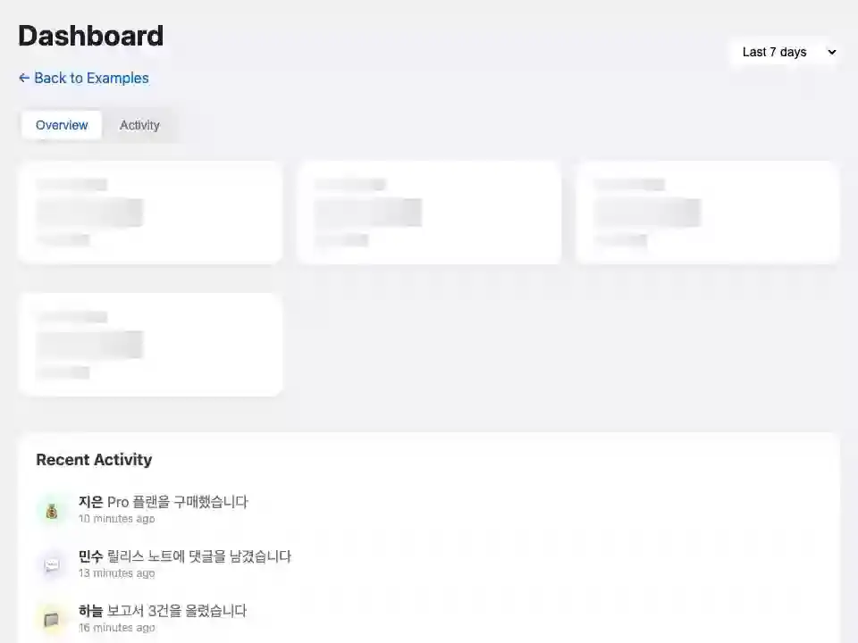

# dashboard

**AsyncResult — 느린 조회가 첫 렌더를 막지 않는다**



<sub>카드마다 느린 조회를 미뤄 두고 먼저 그린다. 다시 불러오면 그 카드만 로딩 상태로 돌아가고, 활동 탭은 더 불러온다. 마지막 화면은 [media/dashboard.png](media/dashboard.png), 다시 만들려면 `make example-media ARGS="--only dashboard"`.</sub>

## 무엇을 보여주나

- `assign_async()`로 카드마다 자기 데이터를 따로 불러온다
- 여러 컴포넌트를 한 페이지에 조합 (카드·피드·탭)
- `wire.params`로 탭과 기간을 URL에 남긴다

## 돌려보기

처음이면 [시작하기](../README.md#시작하기)를 먼저 따라 한다(uv 설치, 의존성, JS 빌드, migrate). 그 뒤로는 서버만 띄운다. WebSocket이 필요하므로 `runserver`가 아니라 daphne다.

```shell
uv run --directory tests daphne testproj.asgi:application
```

브라우저에서 <http://localhost:8000/dashboard/>.

```shell
uv run pytest examples/dashboard -m "not e2e"
```

테스트는 `examples/dashboard/tests.py`. `make test`가 함께 돌리고 릴리스 게이트(CI)가 태그마다 다시 돌리므로 이 예제는 조용히 낡지 않는다.

## 더 읽기

- 튜토리얼: [docs/tutorials/05-dashboard.md](../../docs/tutorials/05-dashboard.md)
- 핵심 파일: live.py · templates/dashboard/
