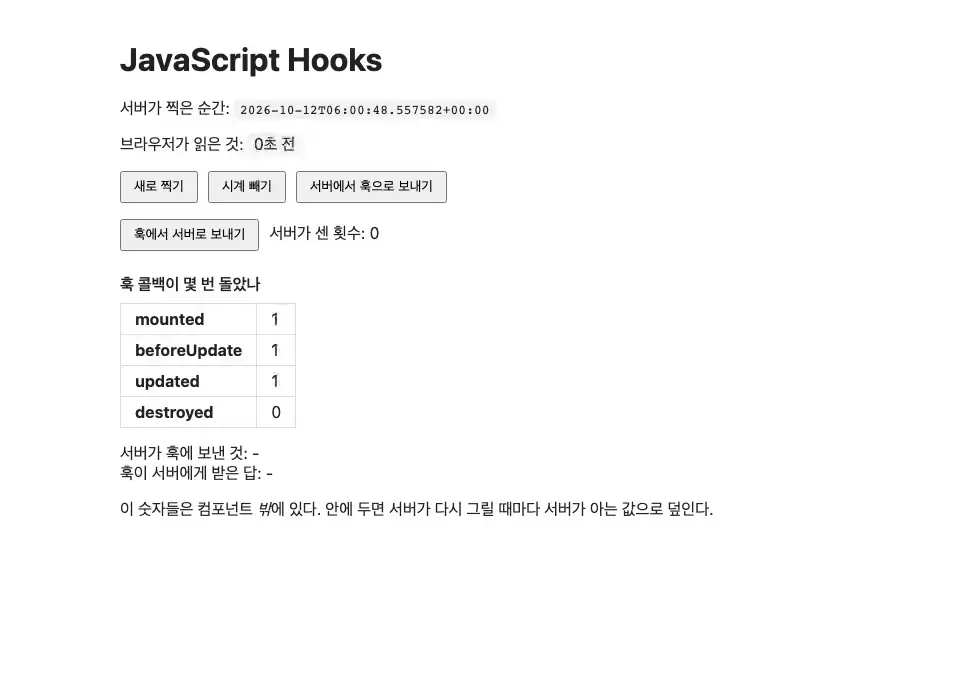

# hooks

**브라우저만 할 수 있는 일을 컴포넌트에 붙인다**



<sub>훅은 브라우저만 할 수 있는 일(지금 시각 기준의 '몇 초 전')을 맡고, 서버와 이벤트를 주고받는다. 마지막 화면은 [media/hooks.png](media/hooks.png), 다시 만들려면 `make example-media ARGS="--only hooks"`.</sub>

## 무엇을 보여주나

- `wire-hook`으로 엘리먼트에 JS 훅을 붙이고, 훅이 서버가 보낸 순간을 **방문자의 시계로** 읽는다
- 수명주기 콜백 넷이 **언제** 도는지 (`mounted` · `beforeUpdate` · `updated` · `destroyed`)
- 훅 → 서버 (`pushEvent` + 콜백)와 서버 → 훅 (`push_event` / `handleEvent`)
- 훅이 쓴 DOM은 다음 렌더에서 서버가 그린 것으로 **덮인다** — 그래서 이 페이지의 숫자들은
  컴포넌트 밖에 있다

## 훅 파일은 어떻게 실리나

**페이지가 훅 파일을 이름으로 부르지 않는다.** `static/hooks/hooks/lifecycle.js`에 있고,
``가 설치된 앱 전부에서 `static/<app_label>/hooks/*.js`를 찾아 `defer`로
싣는다 (GAP-032).

경로가 `hooks/hooks/`인 것은 이 예제 앱의 이름이 마침 `hooks`이기 때문이다. 앞의 것은 앱 라벨
(Django의 정적 파일 네임스페이스), 뒤의 것이 wireview의 규약이다. `myapp`이라면
`myapp/static/myapp/hooks/`가 된다.

`defer` 스크립트는 문서 순서대로 실행되므로, 훅 파일이 돌 때 `window.wireview`는 이미 있다.

그리고 wireview는 **모든 `defer` 스크립트가 실행된 뒤에야 컴포넌트를 join한다.** 이것이 없으면
훅 파일이 조금만 늦게 도착해도 첫 렌더 때 훅이 없고, 남는 흔적은 콘솔 경고 한 줄뿐이다.
`tests.py`의 `test_a_slow_hook_file_still_registers_before_the_first_join`이 그 경합을
훅 파일을 일부러 1초 붙잡아 두고 고정한다. 판단 자체는 `wireview/static/wireview/ready.mjs`에
순수 함수로 있고 `tests/js/ready.test.mjs`가 검사한다.

## 돌려보기

처음이면 [시작하기](../README.md#시작하기)를 먼저 따라 한다(uv 설치, 의존성, JS 빌드, migrate). 그 뒤로는 서버만 띄운다. WebSocket이 필요하므로 `runserver`가 아니라 daphne다.

```shell
uv run --directory tests daphne testproj.asgi:application
```

브라우저에서 <http://localhost:8000/hooks/>.

```shell
uv run pytest examples/hooks -m "not e2e"
uv run pytest examples/hooks -m e2e
```

첫 줄은 브라우저 없이, 둘째 줄은 브라우저로 돈다. 브라우저 테스트는 [시작하기의 테스트](../README.md#테스트)에서 브라우저를 받은 뒤에 돈다.

## 핵심 파일

| 파일 | 무엇 |
|------|------|
| `live.py` | `XLifecycle` — 상태와 `handle_hook_event` |
| `static/hooks/hooks/lifecycle.js` | 훅 둘. 등록은 `window.wireview.hooks.<이름> = {...}` 한 줄 |
| `templates/hooks/x-lifecycle.html` | `wire-hook` 속성이 붙는 곳 |
| `templates/hooks/page.html` | 훅 파일을 **부르지 않는다** — 헤더 태그가 찾아 싣는다 |

## 더 읽기

- 기능 문서: [docs/features/hooks.md](../../docs/features/hooks.md)
- 자동 수집의 설계와 버린 길: [docs/design/colocated-hooks.md](../../docs/design/colocated-hooks.md) (GAP-032)
