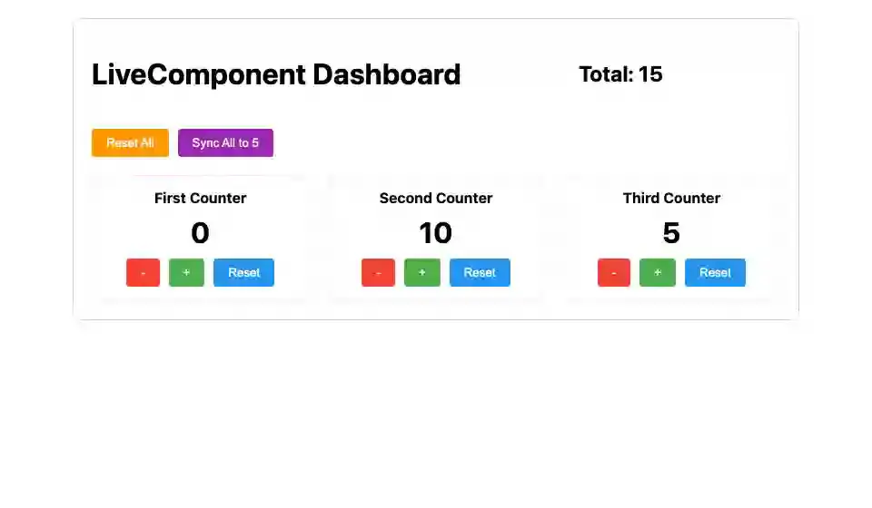

# livecomp

**부모의 연결을 공유하면서 자기 상태를 갖는 중첩 컴포넌트**



<sub>카운터 셋은 각자 상태를 가진 LiveComponent. 하나를 누르면 부모의 합계가, 부모의 버튼은 셋을 함께 바꾼다. 마지막 화면은 [media/livecomp.png](media/livecomp.png), 다시 만들려면 `make example-media ARGS="--only livecomp"`.</sub>

## 무엇을 보여주나

- `` + ``
- `myself=True`로 자기 자신에게 이벤트를 보낸다
- `send_to_parent()`로 부모에게 알리고, 부모가 자식을 갱신한다

## 돌려보기

처음이면 [시작하기](../README.md#시작하기)를 먼저 따라 한다(uv 설치, 의존성, JS 빌드, migrate). 그 뒤로는 서버만 띄운다. WebSocket이 필요하므로 `runserver`가 아니라 daphne다.

```shell
uv run --directory tests daphne testproj.asgi:application
```

브라우저에서 <http://localhost:8000/livecomp/>.

```shell
uv run pytest examples/livecomp -m "not e2e"
uv run pytest examples/livecomp -m e2e
```

첫 줄은 브라우저 없이, 둘째 줄은 브라우저로 돈다. 브라우저 테스트는 [시작하기의 테스트](../README.md#테스트)에서 브라우저를 받은 뒤에 돈다.

테스트는 `examples/livecomp/tests.py`이고 브라우저 테스트가 함께 들어 있다. `make test`가 함께 돌리고 릴리스 게이트(CI)가 태그마다 다시 돌리므로 이 예제는 조용히 낡지 않는다.

## 더 읽기

- 튜토리얼: [docs/tutorials/15-live-components.md](../../docs/tutorials/15-live-components.md)
- 핵심 파일: components.py · templates/livecomp/
