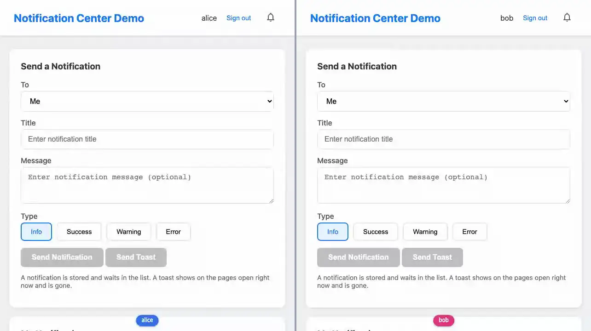

# notifications

**알림은 한 사용자에게 간다. 저장하는 알림과 저장하지 않는 토스트**



<sub>alice가 bob에게 보낸 알림은 bob의 목록과 종에만 온다. 토스트는 저장되지 않고 지금 열린 화면에만 뜬다. 마지막 화면은 [media/notifications.png](media/notifications.png), 다시 만들려면 `make example-media ARGS="--only notifications"`.</sub>

## 무엇을 보여주나

- `get_subscriptions()`가 `self.user`의 채널만 부른다 — 다른 사람에게 보낸 것은 이 연결에 오지 않는다
- 알림(패턴 A): `Notification` 행을 저장하면 자동 브로드캐스트가 받는 사람의 채널
  `auth.user.<pk>.notifications`로 알리고, 목록(Streams)과 벨 배지가 바뀐다
- 토스트(패턴 B): 저장 없이 `atoast(user, ...)`로 보내고, 레이아웃의 ``가 `put_flash()`로 띄운다
- 브라우저가 보낸 id는 믿지 않는다: 모든 핸들러가 소유자로 거른 쿼리에서 시작한다
- `JS()` 체이닝으로 사라지는 애니메이션

보내는 함수와 채널 이름은 `services.py` 한곳에 있다.

## 돌려보기

처음이면 [시작하기](../README.md#시작하기)를 먼저 따라 한다(uv 설치, 의존성, JS 빌드, migrate). 그 뒤로는 서버만 띄운다. WebSocket이 필요하므로 `runserver`가 아니라 daphne다.

```shell
uv run --directory tests daphne testproj.asgi:application
```

브라우저에서 <http://localhost:8000/notifications/>를 열고 alice로 로그인한다. 시크릿 창에서 같은 주소를
열고 bob으로 로그인한다 — 쿠키를 공유하는 창은 같은 사용자다. alice 창을 새로고침해 받는 사람 목록에
bob이 보이면, bob에게 알림과 토스트를 보내 본다. `/notifications/sign-in/<이름>/`은 데모용이다.

```shell
uv run pytest examples/notifications -m "not e2e"
uv run pytest examples/notifications -m e2e
```

첫 줄은 브라우저 없이, 둘째 줄은 브라우저로 돈다. 브라우저 테스트는 [시작하기의 테스트](../README.md#테스트)에서 브라우저를 받은 뒤에 돈다.

테스트는 `examples/notifications/tests.py`. `make test`가 함께 돌리고 릴리스 게이트(CI)가 태그마다 다시 돌리므로 이 예제는 조용히 낡지 않는다.

## 더 읽기

- 튜토리얼: [docs/tutorials/14-notifications.md](../../docs/tutorials/14-notifications.md)
- 플래시와 토스트의 경계: [docs/features/flash.md](../../docs/features/flash.md)
- 핵심 파일: live.py · services.py · templates/notifications/
