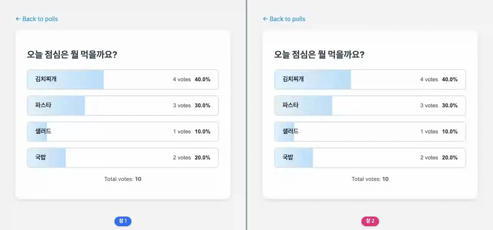

# poll

**쓰기는 핸들러가, 다시 그리기는 브로드캐스트가**



<sub>한 창이 투표하면 두 창의 막대와 표 수가 함께 움직인다. 마지막 화면은 [media/poll.png](media/poll.png), 다시 만들려면 `make example-media ARGS="--only poll"`.</sub>

## 무엇을 보여주나

- 투표는 DB에 쓰고 `skip_render()` — 재렌더는 `mutation()`이 받는다
- 이미 투표했으면 아무것도 하지 않는다 (서버가 판단)
- `wire.params`로 선택을 URL에 남겨 새로고침을 견딘다

## 돌려보기

처음이면 [시작하기](../README.md#시작하기)를 먼저 따라 한다(uv 설치, 의존성, JS 빌드, migrate). 그 뒤로는 서버만 띄운다. WebSocket이 필요하므로 `runserver`가 아니라 daphne다.

```shell
uv run --directory tests daphne testproj.asgi:application
```

브라우저에서 <http://localhost:8000/poll/>.

```shell
uv run pytest examples/poll -m "not e2e"
```

테스트는 `examples/poll/tests.py`. `make test`가 함께 돌리고 릴리스 게이트(CI)가 태그마다 다시 돌리므로 이 예제는 조용히 낡지 않는다.

## 더 읽기

- 튜토리얼: [docs/tutorials/10-poll-app.md](../../docs/tutorials/10-poll-app.md)
- 핵심 파일: live.py · templates/poll/poll.html
