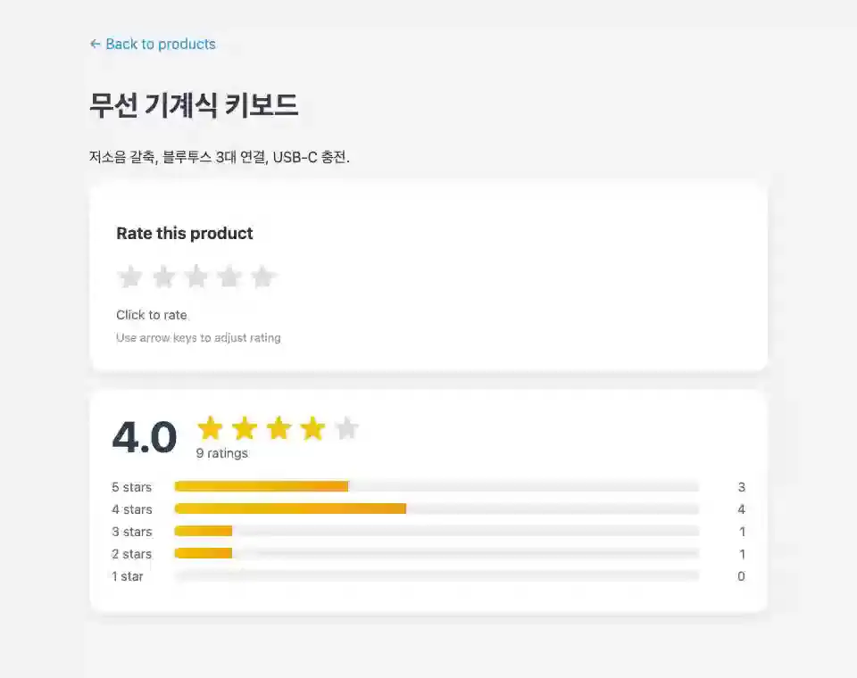

# rating

**잠깐 쓰는 상태(hover)와 남는 상태(점수)를 갈라 둔다**



<sub>별 위를 지나가는 미리보기는 잠깐 쓰는 상태, 누른 별점은 저장되어 통계가 바뀐다. 마지막 화면은 [media/rating.png](media/rating.png), 다시 만들려면 `make example-media ARGS="--only rating"`.</sub>

## 무엇을 보여주나

- hover는 컴포넌트 상태에만, 점수는 DB에 (`aupdate_or_create`)
- 키보드 이벤트와 ``
- 세션 키는 페이지가 넘겨준다 — 소켓은 Django 세션을 들고 있지 않다

## 돌려보기

```bash
make build-js          # 최초 1회
make run-daphne        # WebSocket이 필요하므로 runserver가 아니다
```

브라우저에서 <http://localhost:8000/rating/>.

```bash
make test ARGS="-k rating"
```

테스트는 `examples/rating/tests.py`. `make test`가 함께 돌리고 릴리스 게이트(CI)가 태그마다 다시 돌리므로 이 예제는 조용히 낡지 않는다.

## 더 읽기

- 튜토리얼: [docs/tutorials/11-rating-app.md](../../docs/tutorials/11-rating-app.md)
- 핵심 파일: live.py · views.py · templates/rating/
