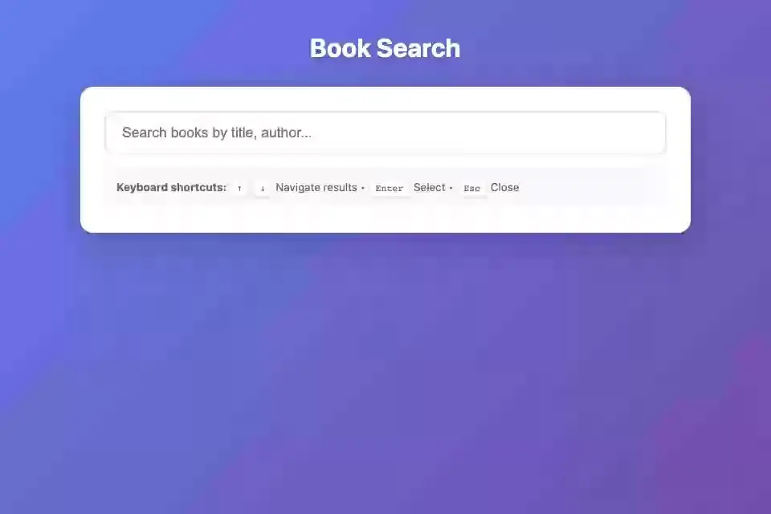

# search

**디바운스한 입력, 주소에 남는 검색어, 키보드로 고르는 결과 목록**



<sub>입력이 멈추면 검색하고, 방향키로 고른 결과를 Enter로 연다. 마지막 화면은 [media/search.png](media/search.png), 다시 만들려면 `make example-media ARGS="--only search"`.</sub>

## 무엇을 보여주나

- `` — 타이핑마다 질의하지 않는다
- 검색어를 `push_to("?q=…")`로 주소에 남기고 결과는 `params_changed()`가 낸다 — 새로고침·공유한 링크·뒤로 가기가 같은 결과를 보여 준다
- 위/아래 키로 결과를 순환 (`navigate`), Enter로 선택
- `push_js(JS()...)`로 입력값을 비우는 등 DOM만의 일은 클라이언트에

## 돌려보기

처음이면 [시작하기](../README.md#시작하기)를 먼저 따라 한다(uv 설치, 의존성, JS 빌드, migrate). 그 뒤로는 서버만 띄운다. WebSocket이 필요하므로 `runserver`가 아니라 daphne다.

```shell
uv run --directory tests daphne testproj.asgi:application
```

브라우저에서 <http://localhost:8000/search/>. 검색한 뒤 새로고침하거나 뒤로 가기를 눌러 본다.

```shell
uv run pytest examples/search -m "not e2e"
uv run pytest examples/search -m e2e
```

첫 줄은 브라우저 없이, 둘째 줄은 브라우저로 돈다. 브라우저 테스트는 [시작하기의 테스트](../README.md#테스트)에서 브라우저를 받은 뒤에 돈다.

테스트는 `examples/search/tests.py`. `make test`가 함께 돌리고 릴리스 게이트(CI)가 태그마다 다시 돌리므로 이 예제는 조용히 낡지 않는다. 브라우저로 입력·새로고침·뒤로 가기를 도는 E2E(`TestQueryInTheAddress`)는 위 둘째 줄이 돌린다.

## 더 읽기

- 튜토리얼: [docs/tutorials/12-live-search.md](../../docs/tutorials/12-live-search.md)
- 핵심 파일: live.py · templates/search/live_search.html
