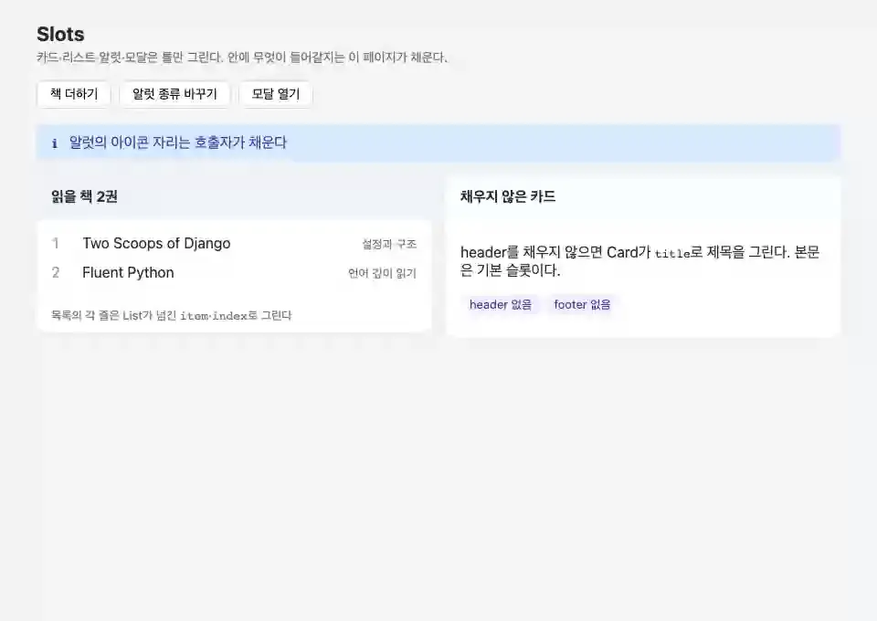

# slots

**내용을 호출자가 채우는 레이아웃 컴포넌트**



<sub>틀은 컴포넌트가, 내용은 호출자가. 페이지가 넘기는 값이 바뀌면 채운 자리도 다시 그려진다. 마지막 화면은 [media/slots.png](media/slots.png), 다시 만들려면 `make example-media ARGS="--only slots"`.</sub>

## 무엇을 보여주나

- `_slots`로 어떤 자리를 받을지 선언 (필수 여부 포함)
- `` + `` + ``
- 카드·리스트·모달·알럿 네 가지 형태

## 돌려보기

네 컴포넌트는 다른 템플릿에서 ``으로 불러 쓰는 틀이다. 함께 쓰는 모습은
`/slots/` 페이지(`SlotsGallery`)에 있다. 그 페이지의 버튼은 모든 `` 밖에 둔다 —
이벤트는 그 요소를 둘러싼 컴포넌트로 가고, fill 안이라면 그것은 슬롯의 주인(Card, List)이다.

```bash
make run-daphne                  # http://localhost:8000/slots/
make test ARGS="-k slots"
```

테스트는 `examples/slots/tests.py`. `make test`가 함께 돌리고 릴리스 게이트(CI)가 태그마다 다시 돌리므로 이 예제는 조용히 낡지 않는다.

## 더 읽기

- 기능 문서: [docs/features/slots.md](../../docs/features/slots.md)
- 핵심 파일: components.py · templates/slots/ (페이지는 gallery.html·page.html)
