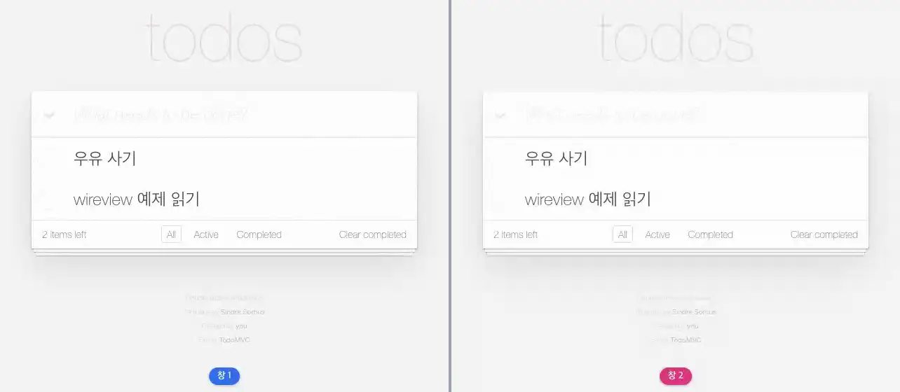

# todo

**모델 구독으로 여러 탭이 같은 목록을 함께 본다**



<sub>한 창에서 할 일을 더하고 끝내면 다른 창의 목록도 그대로 바뀐다. 마지막 화면은 [media/todo.png](media/todo.png), 다시 만들려면 `make example-media ARGS="--only todo"`.</sub>

## 무엇을 보여주나

- `_subscriptions = {"todo.item"}` + `mutation()` — ORM 변경이 곧 화면 갱신
- 중첩 컴포넌트: 목록·항목·카운터가 각자의 컴포넌트
- `skip_render()` / `force_render()`로 렌더 횟수 제어
- ``, ``, ``
- Enter에 즉시 반응: 로딩 클래스만으로 그리는 스피너와 "Adding…" 임시 행 (아래)

## 먼 곳에서도 Enter가 바로 반응하게

서버 처리는 몇 ms지만 멀리서 접속하면 왕복이 1초를 넘는다. 그동안 화면이 가만히 있으면 입력이 먹지 않은 것처럼 보인다.
Enter를 누르면 입력칸에 `wireview-loading`과 `wireview-keypress-loading`이 붙고 **그 이벤트의 응답**이 오면 떨어진다
([docs/features/optimistic-ui.md](../../docs/features/optimistic-ui.md#로딩-클래스)). `static/todo.css`는 이 클래스만 보고

- 입력값을 흐리게 하고 헤더 오른쪽에 스피너를 돌린다(`<input>`은 `::after`를 그리지 않아 헤더에 단다)
- `:has()`로 목록 끝에 "Adding…" 행을 보인다 — 새 항목이 들어올 자리다

JavaScript도 서버 코드도 더하지 않았다. 입력값은 서버가 받은 뒤(`add()`의 `push_js`)에야 지운다 — 먼저 지우면 전송이
실패했을 때 쓴 글이 사라진다. 목록이 비어 있으면 목록 자체가 숨어 있어 임시 행은 없고 스피너만 보인다.

## 돌려보기

```bash
make build-js          # 최초 1회
make run-daphne        # WebSocket이 필요하므로 runserver가 아니다
```

브라우저에서 <http://localhost:8000/>.

```bash
make test ARGS="-k todo"
```

테스트는 `examples/todo/tests.py`이고 브라우저 테스트가 함께 들어 있다 (`make test-e2e LAYER=memory ARGS="-k todo"`). `make test`가 함께 돌리고 릴리스 게이트(CI)가 태그마다 다시 돌리므로 이 예제는 조용히 낡지 않는다.

## 더 읽기

- 튜토리얼: [docs/tutorials/03-todo-app.md](../../docs/tutorials/03-todo-app.md)
- 핵심 파일: live.py · templates/todo/ · models.py
